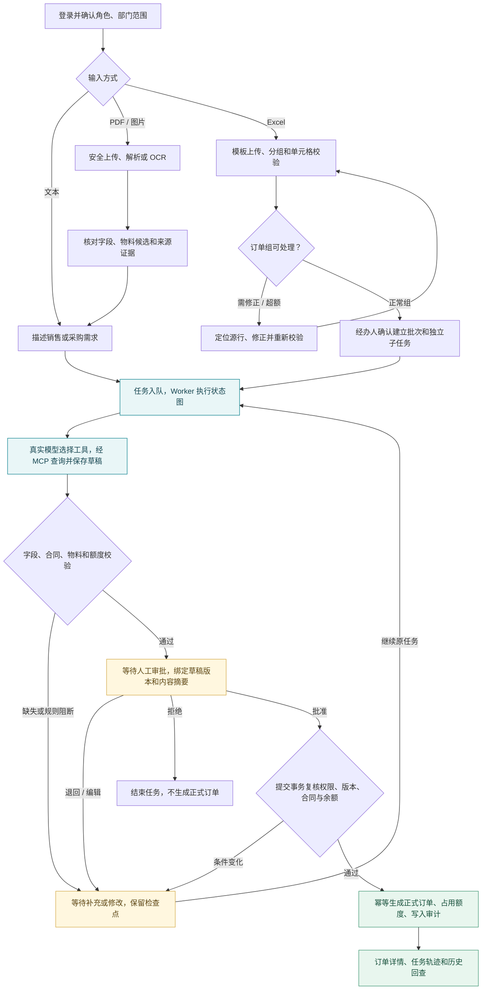
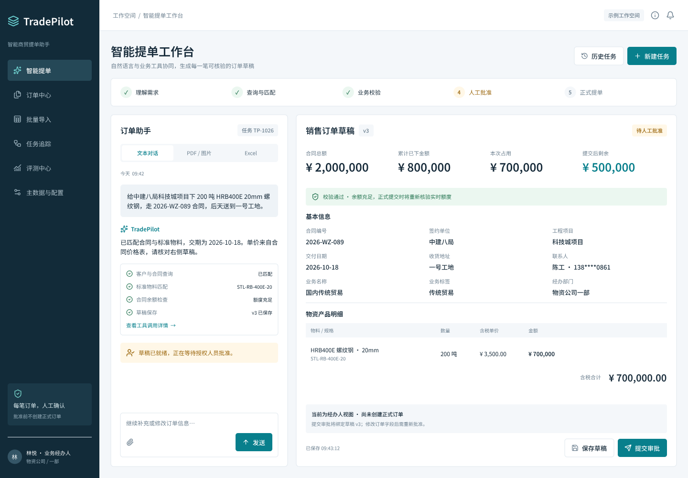
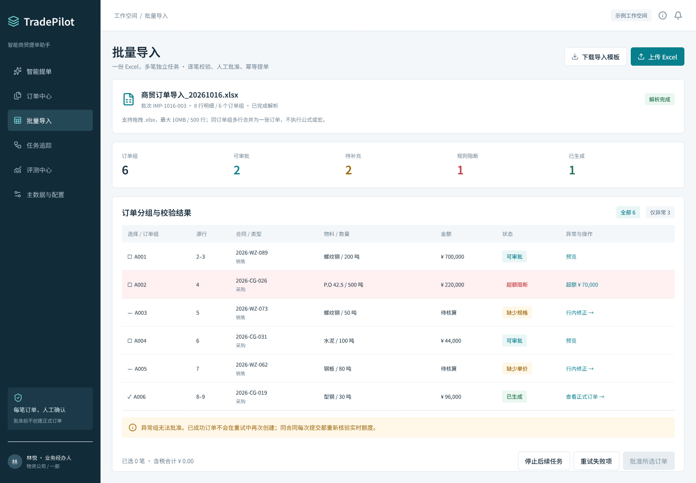
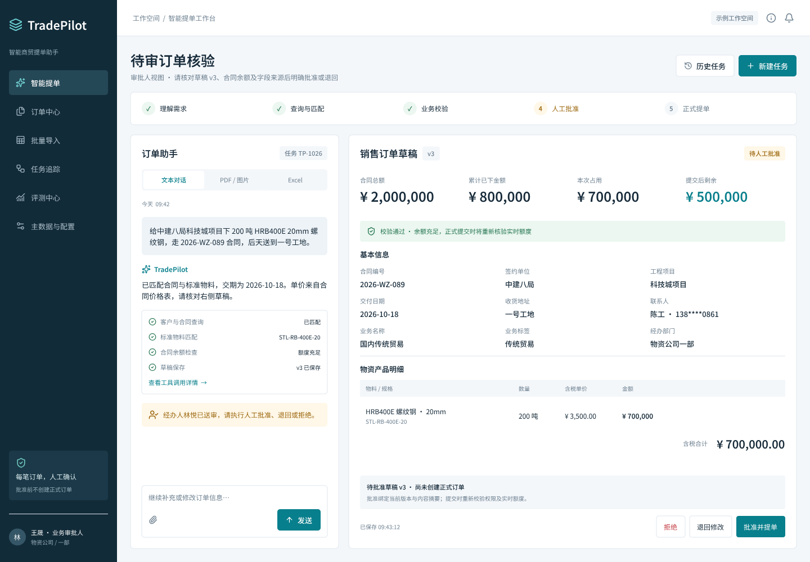
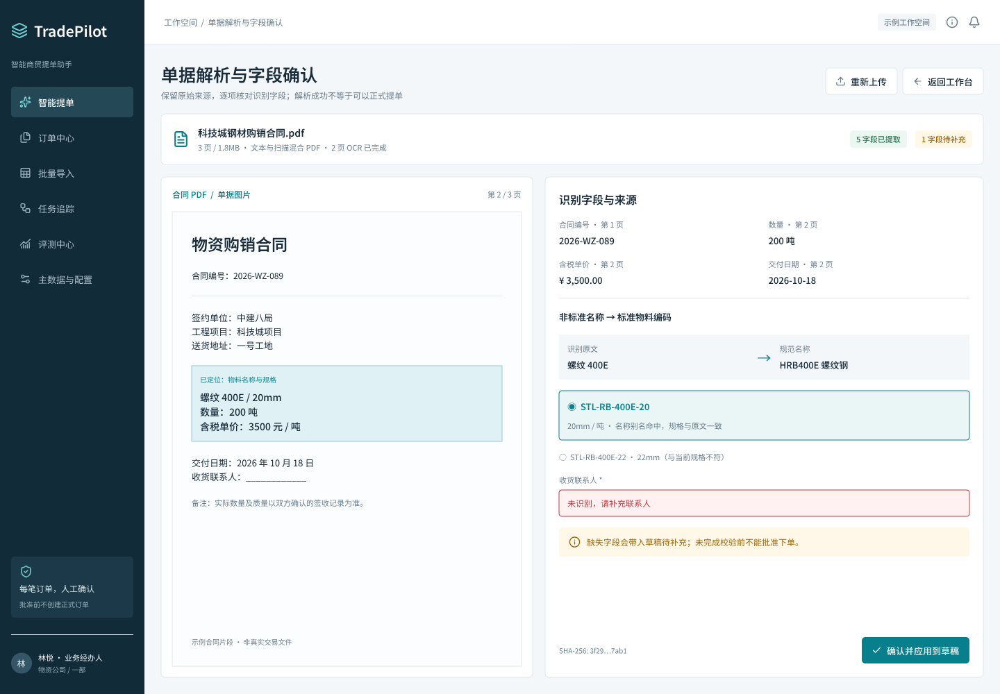
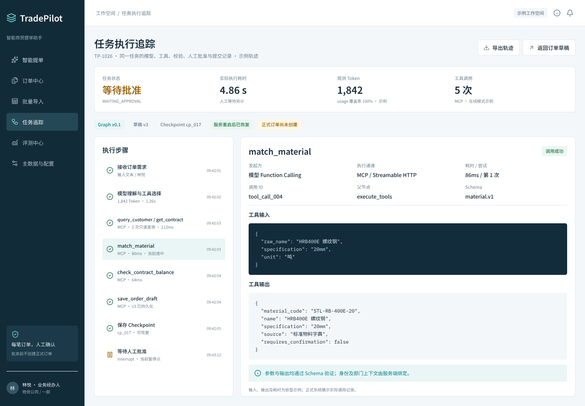
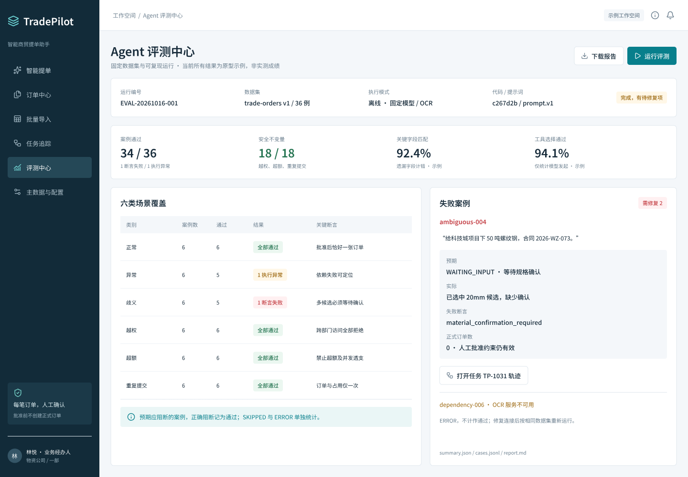
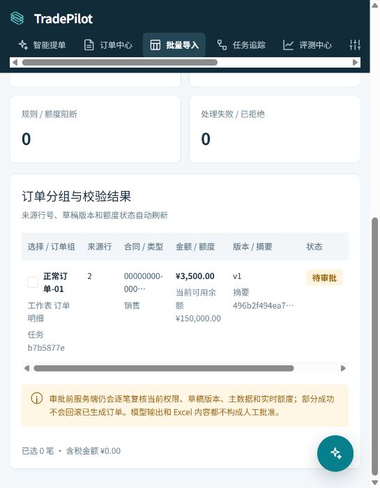

# TradePilot

**把文本、单据和 Excel 订单需求，变成可核验、可审批、可追溯的正式订单。**

TradePilot 是基于 LangGraph 的多模态智能商贸提单 Agent，支持销售与采购场景。经办人提供需求，模型通过 MCP 查询业务资料、生成草稿；系统校验合同与额度，有权限的人员审批后，再由服务端提交正式订单。

[业务流程](#真实业务流程) · [界面展示](#界面与交互设计) · [测试文件](#直接体验与测试文件) · [启动项目](#快速启动) · [文档导航](#文档导航)

> M1–M6 的 42 个实现 issue 已完成合并，当前为本地演示与验收交付版本。后续批量导入与界面修复见[说明](doc/development/UI-IMPORT-FIX.md)。8 小时稳定性观察按用户决定提前结束，未取得完整报告；交付证据与限制见[验收索引](doc/ACCEPTANCE-EVIDENCE.md)。

## 真实业务流程

下图按当前后端状态图、Excel 分组逻辑和提交事务整理。三种输入共享草稿校验、人工审批与正式提单规则。



- **模型负责提出草稿**：工具由真实模型动态选择，MCP 只能查询业务资料、检查余额和保存草稿。
- **人工批准绑定具体版本**：编辑后重新校验、重新审批；管理员身份不自动获得业务审批权。
- **正式提单再次校验**：余额、权限或合同条件变化时阻断提交；幂等控制避免重复生成订单。
- **批次允许部分成功**：各订单组独立处理，失败组保留原因和源行，其他组失败不会回滚已成功订单。

继续阅读：[详细业务流程与代码映射](doc/BUSINESS-FLOW.md) · [PRD](doc/PRD.md) · [技术 Spec](doc/SPEC.md)

## 界面与交互设计

### 工作台与关键业务页面

以下图片来自 `doc/design/exports/`，属于**设计原型**；其中业务数据、轨迹和成绩均为示例。点击图片可查看大图。

[](doc/design/exports/01-workbench.png)

| Excel 批量导入 | 人工审批 |
|---|---|
| [](doc/design/exports/05-batch-import.png) | [](doc/design/exports/09-human-approval.png) |
| 按订单组展示候选结果、错误和处理进度 | 审核草稿、合同额度及版本，批准、退回或拒绝 |

<details>
<summary>展开：来源证据、运行轨迹与自动评测原型</summary>

| 单据来源证据 | Agent 运行轨迹 |
|---|---|
| [](doc/design/exports/12-document-evidence.png) | [](doc/design/exports/06-agent-trace.png) |

[](doc/design/exports/07-evaluation.png)

</details>

完整设计见 [25 个画板说明](doc/design/README.md)、[原型 PDF](doc/design/exports/TradePilot-Prototype-v0.1.pdf) 和[需求覆盖表](doc/design/ACCEPTANCE-COVERAGE.md)。

### 实际运行：Excel 子任务等待审批

以下是 **2026-10-20 本机真实运行截图**：上传合成 Excel 后，正常订单组完成模型与 MCP 处理，金额 3,500 元，进入 `WAITING_APPROVAL`。截图为待审批状态，尚未生成正式订单。

[](doc/images/runtime/batch-waiting-approval.png)

对应构建与浏览器验收记录见[批量导入与界面修复说明](doc/development/UI-IMPORT-FIX.md)。

## 核心能力

| 能力 | 当前实现 | 深入阅读 |
|---|---|---|
| 持久任务与恢复 | LangGraph 检查点、输入及审批中断、持久 Worker、重启续跑 | [任务队列与恢复](doc/development/TASK-QUEUE-BASELINE.md) |
| 真实模型与工具 | Function Calling、Streamable HTTP MCP、严格参数与签名身份上下文 | [MCP 契约](doc/development/MCP-BASELINE.md) |
| 多模态输入 | PDF 文本、图片 OCR、字段来源、Excel 分组与单元格错误定位 | [PRD](doc/PRD.md)、[示例文件](code/examples/README.md) |
| 受控订单提交 | 草稿版本、人工审批、合同规则与额度检查、事务及幂等 | [草稿基线](doc/development/DRAFT-BASELINE.md)、[规则基线](doc/development/CONTRACT-RULES-BASELINE.md) |
| 可回查执行过程 | 全屏与悬浮窗共享任务，历史、Trace/Span、事件与审计 | [可观测性基线](doc/development/OBSERVABILITY-BASELINE.md) |
| 自动评测 | 六类固定数据集、隔离评测库、离线与在线报告、失败案例追踪 | [报告口径](doc/development/EVALUATION-REPORTS.md) |

## 直接体验与测试文件

本地服务启动后，打开[前端工作台](http://localhost:5173/)；Excel 上传入口为[批量导入](http://localhost:5173/imports)。

示例统一放在 `code/examples/`，使用合成资料，结果以当前数据库中的合同、物料和余额为准。

| 文件 | 用途与预期 |
|---|---|
| [01-正常订单.xlsx](code/examples/01-正常订单.xlsx) | 正常订单组，继续模型处理与人工审批 |
| [02-正常与错误数量.xlsx](code/examples/02-正常与错误数量.xlsx) | 正常组与异常组并存，定位 `订单明细!J3` 数量错误 |
| [03-超额订单.xlsx](code/examples/03-超额订单.xlsx) | 金额 175,000 元，在示例余额 150,000 元时提示超额 |
| [04-销售订单文本.pdf](code/examples/04-销售订单文本.pdf) | 带文本层的单据解析 |
| [05-销售订单扫描.pdf](code/examples/05-销售订单扫描.pdf) | 扫描单据 OCR 与人工核对 |

具体上传步骤见[手工验收指南](code/examples/README.md)。

## 快速启动

环境要求：PowerShell 7、Docker Desktop（Linux 容器）、Docker Compose v2、`uv`、Python 3.12；前端独立开发还需 Node.js 22.12+。

### 1. 准备后端环境

在仓库根目录运行：

```powershell
if (-not (Test-Path code/backend/.env)) {
    Copy-Item code/backend/.env.example code/backend/.env
}
uv python install 3.12
uv sync --project code/backend --locked
```

编辑本机 `code/backend/.env`，按[环境示例](code/backend/.env.example)配置：

| 配置 | 要求 |
|---|---|
| 业务库与评测库 | 分别设置数据库名、账号、强口令及连接 URL，使用不同凭据 |
| `DEMO_MODE` / `DEMO_PASSWORD` | 仅演示环境启用；初始示例账号密码至少 12 位 |
| `MCP_CONTEXT_SIGNING_KEY` | 至少 32 字符的随机密钥，API、Worker、MCP 共享；缺失会导致真实任务调用失败 |
| `RUNTIME_CONFIG_ENCRYPTION_KEY` | 按环境说明配置 Fernet 密钥，用于运行配置中的凭据加密 |
| `MODEL_PROVIDER` / `MODEL_NAME` / `MODEL_API_KEY` / `MODEL_BASE_URL` | 与实际供应商、模型及端点一致，在线流程需要可用额度 |
| `OCR_PROVIDER` | 本地默认 `local_tesseract` |
| `APP_ORIGIN` / `SESSION_COOKIE_SECURE` | 本机 HTTP 使用 `http://localhost:5173` 与 `false`；部署 HTTPS 时调整 |

### 2. 初始化并启动

以下以**全新环境**的 Compose 项目名 `tradepilot` 为例，先启动数据库，再迁移和初始化，最后启动业务服务。

**当前开发机现有项目名为 `code`。继续使用现有数据时，将下面项目名改为 `code`，避免启动第二套同端口实例。**

```powershell
Push-Location code
$composeArgs = @('compose', '--project-name', 'tradepilot',
    '--env-file', 'backend/.env', '--file', 'compose.yaml')
docker @composeArgs build api web
docker @composeArgs up --detach --wait db eval-db
docker @composeArgs run --rm --no-deps api uv run --frozen alembic upgrade head
docker @composeArgs run --rm --no-deps api uv run --frozen python -m app.seed
docker @composeArgs up --detach --wait api mcp worker web
Pop-Location
```

`app.seed` 用于初始化演示账号和主数据；已有业务数据时先阅读[数据库基线](doc/development/DATABASE-BASELINE.md)，不要把初始化当成日常启动步骤。

| 服务 | 本机默认地址 |
|---|---|
| 前端 | [localhost:5173](http://localhost:5173/) |
| API 就绪检查 | [localhost:8010/health/ready](http://localhost:8010/health/ready) |
| MCP | `http://localhost:8001/mcp`，容器内部为 `http://mcp:8000/mcp` |
| 业务 PostgreSQL | `localhost:55432` |

初始账号包括 `demo-operator-north`、`demo-operator-south`、`demo-approver-north`、`demo-admin`，密码使用本机 `DEMO_PASSWORD`。角色与审批边界见[登录授权基线](doc/development/AUTH-BASELINE.md)。

### 3. 停止服务并保留数据

在 `code/` 目录使用相同项目名：

```powershell
docker compose --project-name tradepilot --env-file backend/.env --file compose.yaml down
```

运行、备份、恢复和资源清理说明见[交付指南](doc/DELIVERY-GUIDE.md)。

## 可复验场景

脚本使用隔离 Compose 项目与合成数据，依赖及结果口径见[本地环境](doc/development/LOCAL-ENVIRONMENT.md)和[验收索引](doc/ACCEPTANCE-EVIDENCE.md)。

```powershell
# 完整离线评测，输出 JSON、JSONL 与 Markdown
pwsh -NoProfile -File code/scripts/verify_issue_037.ps1

# API、XLSX、恢复、浏览器与备份还原短验收
pwsh -NoProfile -File code/scripts/verify_issue_041.ps1 -SkipSoak

# 文本、OCR/额度、Excel 部分成功、双模式、轨迹与评测演示
pwsh -NoProfile -File code/scripts/demo_issue_042.ps1 -Scenario All

# 真实模型在线验收：需要有效模型配置与额度，可能产生费用
pwsh -NoProfile -File code/scripts/verify_issue_014.ps1 -LiveModel
```

离线夹具、真实服务集成、在线模型结果分别记录，不能相互替代。

## 文档导航

| 想了解什么 | 入口 |
|---|---|
| 产品与角色协作 | [PRD](doc/PRD.md)、[真实业务流程](doc/BUSINESS-FLOW.md) |
| 架构、数据模型与接口 | [Spec](doc/SPEC.md)、[技术基线](doc/development/TECHNICAL-BASELINE.md) |
| 原型和页面覆盖 | [原型说明](doc/design/README.md)、[原型 PDF](doc/design/exports/TradePilot-Prototype-v0.1.pdf)、[覆盖表](doc/design/ACCEPTANCE-COVERAGE.md) |
| 运行、演示、备份恢复 | [交付指南](doc/DELIVERY-GUIDE.md)、[本地环境](doc/development/LOCAL-ENVIRONMENT.md) |
| 实现依据与验收结果 | [验收索引](doc/ACCEPTANCE-EVIDENCE.md)、[评测报告口径](doc/development/EVALUATION-REPORTS.md) |
| 后续开发与提交规范 | [仓库约定](AGENTS.md)、[issue 交付规范](doc/development/ISSUE-DELIVERY.md) |
| 所有说明 | [文档总目录](doc/README.md) |

## 技术栈与目录

Python 3.12 / uv / FastAPI / LangGraph / SQLAlchemy / Alembic / PostgreSQL / MCP SDK / Tesseract；Vue 3 / TypeScript / Vite / Node.js 22；Docker Compose。

```text
code/
├── backend/      API、领域规则、状态图、Worker 与 MCP
├── frontend/     工作台、批量导入、审批与订单页面
├── evals/        固定评测数据和评测执行
├── examples/     可上传的 Excel / PDF 合成示例
├── scripts/      启动、验收、演示与运维脚本
└── tests/        分 issue 的验证入口
doc/
├── PRD.md / SPEC.md / BUSINESS-FLOW.md
├── design/       可编辑原型、画板导出与覆盖表
├── images/       文档引用的真实运行截图
└── development/  实现基线与环境说明
```

## 已知限制

- 8 小时稳定性观察未完成，按用户决定约两小时后停止。
- 本机性能样本与浏览器矩阵不代表生产容量或 SLA。
- 在线模型样本有限，不能据此推断普遍准确率。
- 生产 HTTPS、客户数据迁移、真实 ERP 对接、生产数据规模和合规认证尚未验证。
- OCR 与超额规则有各自集成验证，目前演示未证明同一张图片经在线 Agent 完成全链路超额拦截。

正式订单始终需要有权限的人工审批，以及服务端对合同、权限、版本和余额的再次校验。
