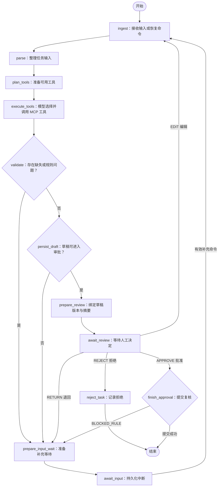
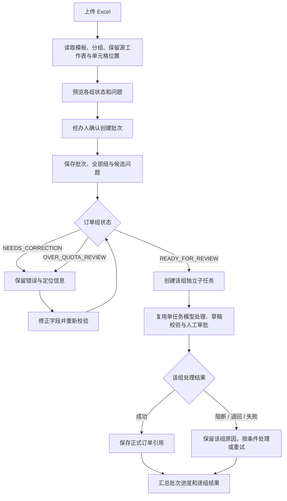
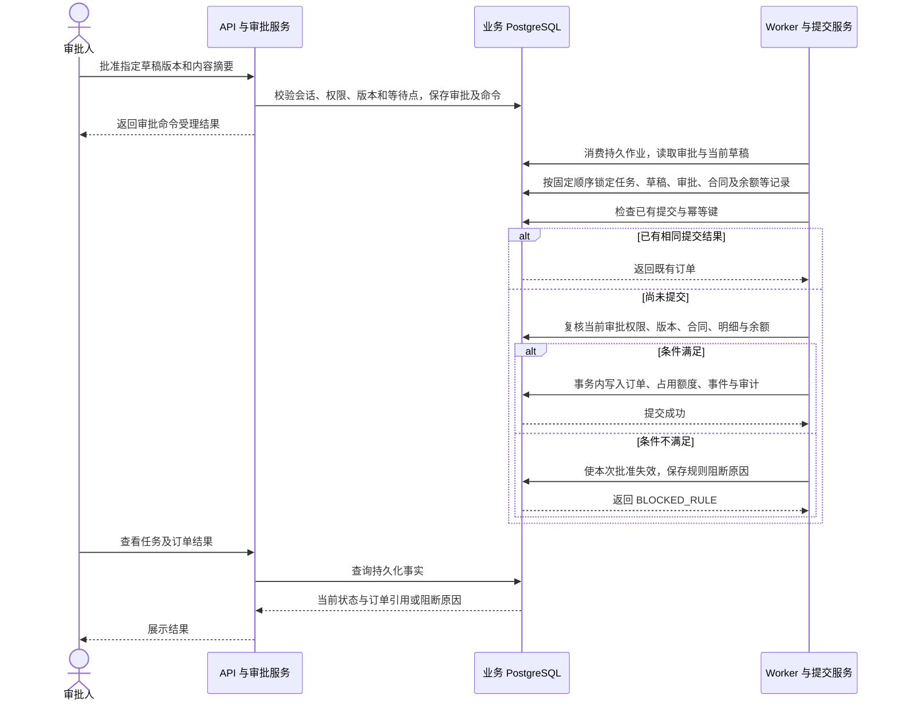
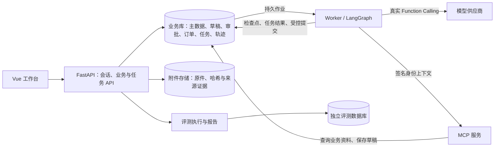

# TradePilot 真实业务流程

[返回项目首页](../README.md) · [PRD](PRD.md) · [技术 Spec](SPEC.md) · [验收证据](ACCEPTANCE-EVIDENCE.md)

本文以当前代码为依据，描述业务参与者、任务状态、批次分支和提交事务。图中的英文是代码节点或持久化状态名，中文说明其业务含义。设计原型用于说明交互，真实运行结果以任务、草稿、审批和订单记录为准。

## 1. 谁负责什么

| 参与者 | 主要动作 | 业务边界 |
|---|---|---|
| 经办人 | 输入需求、上传单据、确认候选、补充字段、修改草稿、处理批次错误 | 受角色和部门范围限制 |
| 模型与 MCP | 识别需求、动态选择工具、查客户与物料、读取合同和余额、保存草稿 | 不能批准或创建正式订单 |
| 审批人 | 核对草稿与证据，批准、退回或拒绝 | 批准绑定草稿 ID、版本、内容摘要及等待点；默认禁止自审 |
| Worker 与领域服务 | 执行状态图、持久化检查点、恢复任务、复核审批后提交 | 以服务端权限、业务规则和事务结果为准 |
| 管理员 | 主数据、运行配置、审计与评测管理 | 管理员角色不自动包含业务审批权限 |

## 2. 三条输入路径

| 路径 | 进入任务前 | 后续共同流程 |
|---|---|---|
| 文本 | 描述销售或采购需求 | 模型工具调用 → 草稿校验 → 人工审批 → 事务提交 |
| PDF / 图片 | 上传校验、文本解析或 OCR、核对字段与来源、确认候选 | 确认后进入同一任务流程；识别内容仍需业务校验 |
| Excel | 模板读取、按订单组分组、校验单元格、预览并确认建立批次 | 正常组生成独立子任务，逐组执行同一任务流程 |

入口总图见[README](../README.md#真实业务流程)。单据证据交互参考[原型 12](design/exports/12-document-evidence.png)，Excel 入口参考[原型 05](design/exports/05-batch-import.png)；两者均为设计图。

## 3. 单任务状态图：从输入到人工审批

下图直接对应 `build_task_graph` 中注册的节点和条件边。`persist_draft` 核验已保存的草稿事实；草稿实际写入发生在 MCP 工具执行过程中，不应理解为这里再次生成一份草稿。

工具集合包括 `query_customer`、`match_material`、`get_contract`、`check_contract_balance`、`save_order_draft`。实际调用次序及是否重复查询由模型根据任务选择，图中的 `plan_tools` 不代表固定串行调用全部工具。

### 页面状态如何理解

| 状态 | 含义 | 经办人或审批人下一步 |
|---|---|---|
| `WAITING_INPUT` | 当前信息不完整，任务在输入等待点中断 | 按字段及原因补充，继续原任务 |
| `BLOCKED_RULE` | 合同、物料、额度等规则不满足 | 修正草稿或业务条件，再校验和审批 |
| `WAITING_APPROVAL` | 有可审批的有效草稿版本 | 由有权限人员批准、退回、拒绝或编辑 |
| `COMPLETED` | 正式订单提交成功，有可回查的订单引用 | 查询订单详情、任务轨迹和审计 |
| `REJECTED` | 人工拒绝，当前任务结束 | 查看拒绝原因；不会产生正式订单 |

以上列出主业务状态，不枚举排队、运行、失败和取消等调度状态。执行异常应先判断是否可重试，不能把任意失败都当成“等待补充”。

## 4. Excel 批次：修正、审批与部分成功

- 初次创建批次时，只有 `READY_FOR_REVIEW` 组创建子任务。错误组与超额组仍保存在批次里，修正后重新判断是否可处理。
- 批次修正受权限、合同规则和编辑版本约束；不能用前端修改绕过服务端校验。
- 批量审批仍逐组核验草稿版本和审批条件，可能出现部分成功；不会把整个批次当成一次不分组的大提交。
- 停止批次针对尚未开始的处理，不撤销已经生成的正式订单。

实测样例：[正常文件](../code/examples/01-正常订单.xlsx)、[正常与错误数量](../code/examples/02-正常与错误数量.xlsx)、[超额文件](../code/examples/03-超额订单.xlsx)。[操作步骤及预期](../code/examples/README.md)说明了示例合同与余额前提。

## 5. 批准到正式订单：提交时序

点击“批准”与正式订单提交完成是不同步骤。提交阶段仍会重新读取当前角色、部门、草稿版本、合同和余额。并发审批、重复命令、Worker 重启或响应丢失不能成为重复建单的理由。

## 6. 运行架构与恢复

- 同一任务始终使用稳定的任务 ID 作为图的 `thread_id`，检查点存入 PostgreSQL。
- 输入、审批恢复命令必须匹配当前检查点、等待点和图版本，过期命令不能恢复其他等待点。
- Worker 使用租约、执行代次与 fencing 约束并发执行；崩溃恢复先读取既有状态，继续尚未完成的节点。
- 提交结果不明时先核验订单与幂等记录，不能直接重新创建订单。
- 评测库与业务库使用独立凭据；离线夹具、真实服务集成和在线模型结果分别报告。

## 7. 流程与实现依据

| 流程部分 | 实现入口 | 文档依据 |
|---|---|---|
| 状态图与输入、审批中断 | [agent/workflow.py](../code/backend/app/agent/workflow.py) | [Spec](SPEC.md)、[任务恢复基线](development/TASK-QUEUE-BASELINE.md) |
| Worker 执行与业务回调 | [worker/workflow.py](../code/backend/app/worker/workflow.py) | [任务恢复基线](development/TASK-QUEUE-BASELINE.md) |
| 模型动态选工具 | [agent/function_calling.py](../code/backend/app/agent/function_calling.py) | [MCP 基线](development/MCP-BASELINE.md) |
| 签名上下文与工具服务 | [mcp_server](../code/backend/app/mcp_server/) | [MCP 基线](development/MCP-BASELINE.md) |
| 文件解析与来源 | [parsing](../code/backend/app/parsing/) | [PRD](PRD.md)、[原型 12](design/exports/12-document-evidence.png) |
| Excel 分组、批次及子任务 | [imports/batches.py](../code/backend/app/imports/batches.py) | [示例指南](../code/examples/README.md)、[原型 05](design/exports/05-batch-import.png) |
| 批准后的原子提交 | [orders/commit.py](../code/backend/app/orders/commit.py) | [草稿基线](development/DRAFT-BASELINE.md)、[规则基线](development/CONTRACT-RULES-BASELINE.md) |
| 检查点持久化 | [tasks/checkpointer.py](../code/backend/app/tasks/checkpointer.py) | [任务恢复基线](development/TASK-QUEUE-BASELINE.md) |
| 实际前端页面 | [frontend/src/views](../code/frontend/src/views/) | [原型覆盖表](design/ACCEPTANCE-COVERAGE.md)、[界面修复记录](development/UI-IMPORT-FIX.md) |

业务总图描述当前实现路径，不代表每一条路径都已完成生产验收。在线样本、OCR 全链路和稳定性观察的验证范围见[交付指南](DELIVERY-GUIDE.md)和[验收证据](ACCEPTANCE-EVIDENCE.md)。
