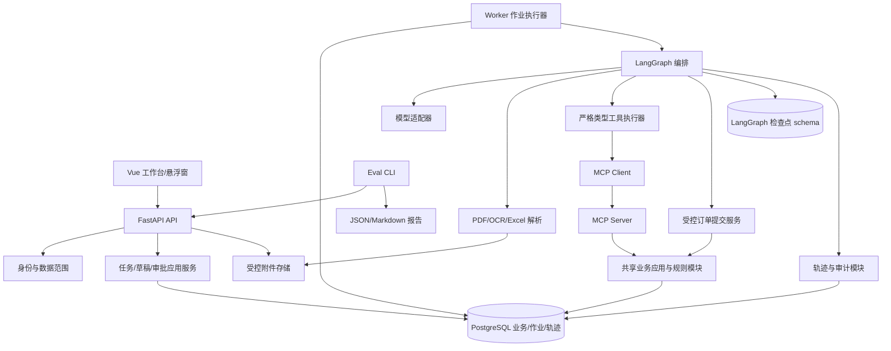
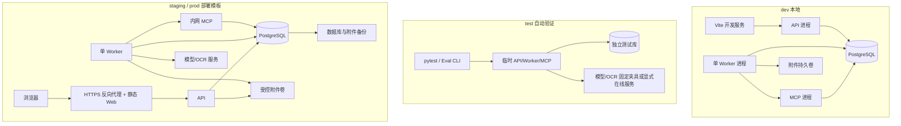
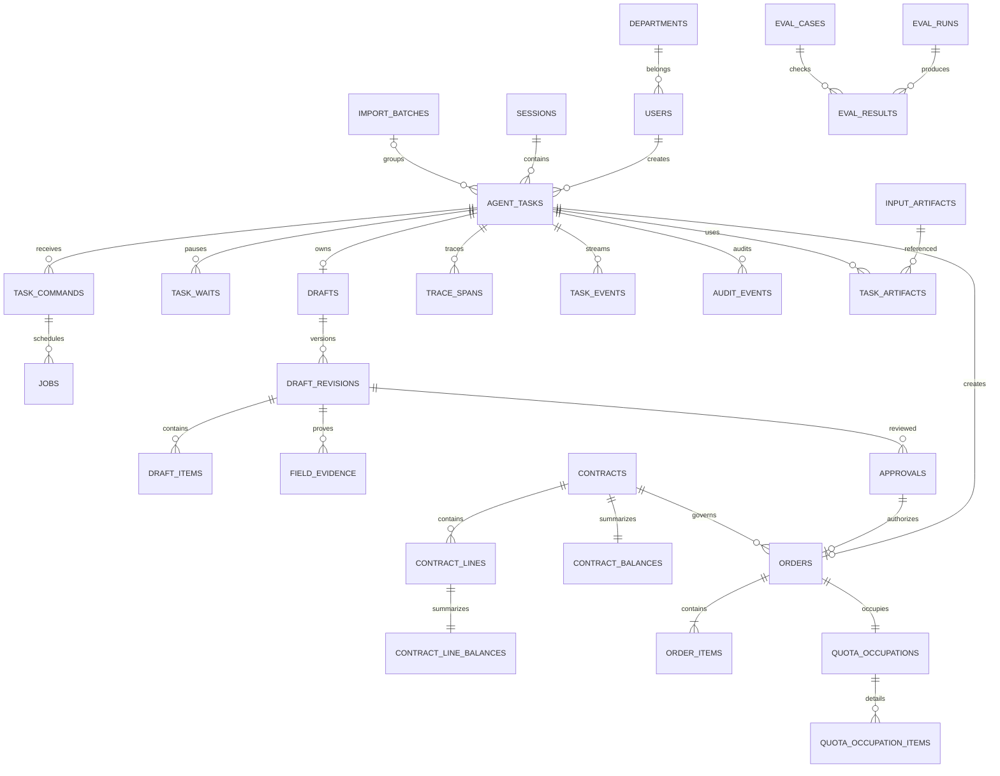
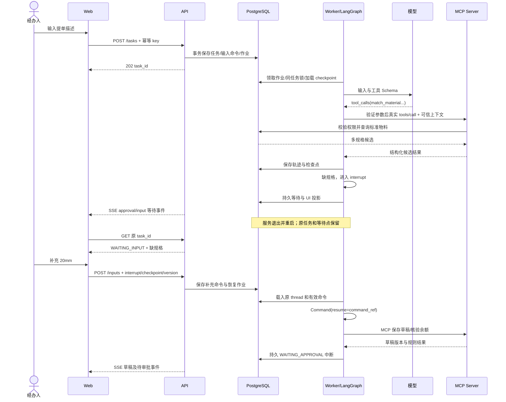
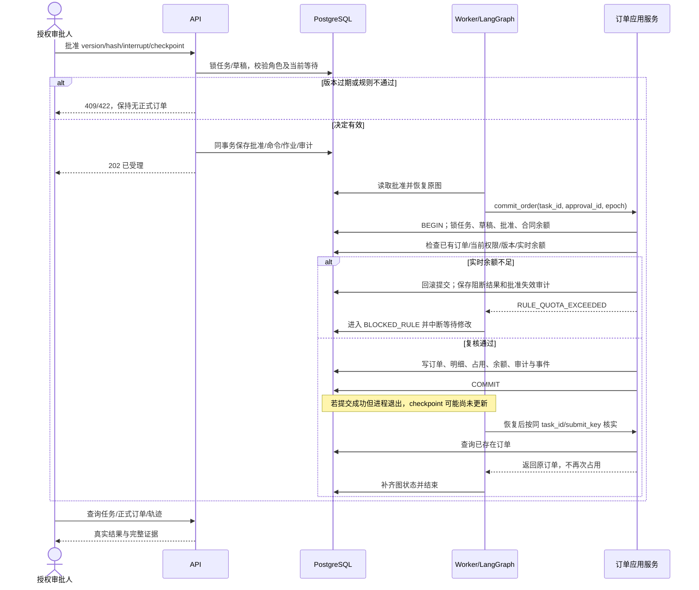

# TradePilot 智能商贸提单助手 · 技术设计规格说明书

| 元信息 | 内容 |
|---|---|
| 文档名称 | TradePilot Design Spec |
| 版本 | v0.1 |
| 架构师角色 | 系统架构设计 |
| 日期 | 2026-10-16 |
| 状态 | 评审稿，尚未实现；待明确事项不视为已确认约束 |
| 依据 PRD | [TradePilot PRD v0.1](./PRD.md) |
| 代码现状 | 当前仓库包含 README 与需求文档，本稿定义后续实现基线 |
| 设计重点 | LangGraph、Function Calling + MCP、多模态、人工介入、可观测性、自动评测 |

本文继承 PRD 的范围、权限与业务规则。技术选型沿用 README 的方向，新增组件均为本稿推荐；数值目标引用 PRD 的建议验收基线，不代表已有运行结果。各图与代码片段用于定义设计契约，不宣称可以直接运行。

## 1. 架构设计概述

### 1.1 架构风格与部署单元

采用前后端分离、模块化单体业务后端，以及独立 MCP 业务工具服务。后端 API 与工作流 Worker 使用同一 Python 代码包，运行在不同进程；业务规则集中在共享的应用服务与领域模块中，API、Worker 和 MCP 不各自复制规则。

基础部署包含五个单元：Web、API、Worker、MCP Server、PostgreSQL。附件使用受控持久卷。先用 PostgreSQL 持久任务表驱动作业，不引入额外消息中间件；Redis、向量数据库和 Kubernetes 不作为首版运行前提。该划分让任务恢复、真实 MCP 边界和数据库事务都能独立观察，同时控制运行复杂度。

前端只通过 API 操作业务资源。Worker 负责编排和模型调用；MCP Server 暴露可复用业务查询与草稿工具；正式订单创建由 Worker 调用受控应用服务。模型工具白名单不包含创建正式订单、修改批准或修改权限的能力。

### 1.2 六项能力的实现与证据

| 技术能力 | 设计落点 | 必须保留的运行证据 | PRD 映射 |
|---|---|---|---|
| LangGraph 状态化工作流 | StateGraph、条件边、持久 checkpointer、输入及审批 interrupt、持久命令 | 同一 task/thread 的检查点、等待原因、重启前后版本、恢复节点 | FR-02/03/04/05 |
| Function Calling + MCP | 工具 Schema 注册、模型 tool_calls、受控执行器、真实 MCP client/server | 模型调用 ID、工具选择、验证结果、协议、真实输入输出与调用时间 | FR-06/07/08 |
| 多模态信息提取 | PDF 文本/扫描分流、OCR 适配器、XLSX 分组解析、统一 CandidateOrder | 原页/区域/单元格、原始值、标准值、候选与确认记录 | FR-09/20/21/22/23/24 |
| Human-in-the-loop | 草稿版本快照、真实人工动作、审批中断、提交前确定性复核 | 批准人、版本及内容哈希、失效记录、阻断原因、正式订单关联 | FR-10/11/12/13/14/15 |
| Agent 可观测性 | 本地持久 trace、审计、事件流、模型/工具 span | 节点、耗时、可用 Token、错误、重试、父子任务、附件证据 | FR-18/19/26 |
| Agent Evaluation | 固定夹具、离线/在线模式、真实规则断言、分类报告 | 数据集与配置版本、逐例结果、指标分母、失败轨迹 | FR-27/28 |

### 1.3 不可破坏的系统约束

1. 模型输出属于候选信息，不是权限、余额、批准或订单存在性的权威来源。
2. 没有当前版本的有效人工批准，正式订单不得存在；超过实时额度，任何入口都不得创建订单。
3. 工作流执行按至少一次尝试设计；正式订单及额度占用通过数据库事务、唯一约束与幂等收敛到一次业务结果。
4. 检查点、业务数据和轨迹各有职责。检查点恢复执行位置；业务表决定草稿版本、批准及订单事实；轨迹解释执行过程。不得从“工具日志显示成功”推断订单已生成。
5. 重试、服务恢复和前端断线都沿用原 task_id，不通过新建任务规避恢复问题。
6. 已批准内容发生业务字段修改则批准失效；旧页面、旧中断、旧版本的动作不能放行新版本。

### 1.4 需求覆盖边界

FR-01～FR-19 全部纳入阶段 A；FR-20～FR-25 在阶段 B 完成；FR-26～FR-28 在阶段 C 完成。阶段 A 已包含基础工具追踪与订单列表，阶段 B 补齐双模式和文件链路；阶段 C 增强分析能力。FR-29 运行参数对比、FR-30 外部 ERP 适配只保留扩展点。

## 2. 技术栈与依赖

### 2.1 推荐基线

| 层次 | 技术与依赖 | 来源 | 用途及约束 |
|---|---|---|---|
| 前端 | Vue 3、TypeScript、Vite、Tailwind CSS | README 方向；Vite 为新增推荐 | 工作台、批量页、轨迹页、悬浮窗共享一套组件 |
| 前端状态 | Pinia、Vue Router | 新增推荐 | task_id、消息、编辑缓冲、视图模式；服务端快照为业务权威 |
| API | Python 3.12、FastAPI、Pydantic 2 | README 方向；版本为推荐 | HTTP 契约、身份鉴权、严格校验、事件流 |
| 工作流 | LangGraph、LangChain 的模型/消息适配能力 | 用户指定/实现推荐 | 显式 StateGraph 与有界工具循环，避免无上限自主执行 |
| 检查点 | langgraph-checkpoint-postgres、psycopg | 新增推荐 | PostgreSQL 持久检查点，独立 schema 与连接池 |
| MCP | 官方 Python SDK `mcp`，Streamable HTTP | 用户指定/新增推荐 | 工具发现、调用和结构化输出；具体 SDK 版本与协议能力锁定 |
| 数据访问 | SQLAlchemy 2、Alembic、PostgreSQL 18 | README 方向；版本为推荐 | 事务、迁移、版本锁、作业队列、审计、轨迹 |
| 文件 | PyMuPDF、openpyxl、Pillow、OCR Adapter | README 方向；Pillow 为新增推荐 | PDF 逐页提取/渲染、XLSX 安全读取、图片预处理 |
| 模型适配 | 支持工具调用的模型供应商适配器 | README 方向 | 统一消息、tool_calls、结构化提取、usage 与错误；供应商待确认 |
| 可观测 | PostgreSQL trace + 结构化日志；OpenTelemetry 接口 | 新增推荐 | 本地轨迹完整可用；LangSmith/Langfuse 为可选导出后端 |
| 评测 | pytest、独立 eval CLI、JSON/Markdown 报告 | README 方向/新增推荐 | 规则测试、故障注入、固定案例和在线模型评测 |
| 交付 | Docker Compose、uv、Node.js 22、前端锁文件 | README 方向；工具/版本为推荐 | 可重复构建，依赖锁定；本地 Windows 支持容器运行 |

版本数字用于建立一致开发环境，不表示“当前最新”。实施 T-01 时创建 Python 与前端锁文件，对 LangGraph、checkpointer、MCP SDK、数据库驱动做兼容性验证；本稿不虚构已验证的精确依赖版本。PDF 解析依赖的许可证与再分发条件纳入 T-01 检查。

### 2.2 协议与版本管理

MCP 使用官方 SDK；SDK 支持客户端、服务端及 Streamable HTTP，具体 API 以锁定版本为准，避免混用不同大版本示例。[官方 Python SDK](https://github.com/modelcontextprotocol/python-sdk)

MCP 工具使用 `inputSchema`、`outputSchema` 与结构化结果定义契约。Schema 注册表与模型工具描述从同一来源生成，避免两份定义漂移。[MCP 工具规范](https://modelcontextprotocol.io/specification/2025-11-25/server/tools)

协议兼容测试以 2025-11-25 文档为参考基线，初始化时按实际 SDK 协商双方支持的版本，结果写入调用轨迹。实施时确定允许版本集合并冻结；不把参考版本等同于最新版本，也不在业务代码中手工复制传输协议。[MCP 传输规范](https://modelcontextprotocol.io/specification/2025-11-25/basic/transports)

### 2.3 配置分类

- 运行配置：数据库地址、附件根目录、MCP 地址、并发数、超时、重试、模型标识、OCR 适配器。
- 业务配置：业务时区 `Asia/Hong_Kong`、审批模式、固定业务属性、文件上限、额度规则版本、订单编号前缀。
- 密钥：由环境或部署密钥文件注入，只保存引用；前端与数据库配置查询不返回密钥。
- 每次运行保存配置快照哈希、图版本、提示词版本、工具 Schema 版本、模型标识、代码版本；运行中不隐式切换配置。安全敏感配置及权限始终按当前有效策略复核。

## 3. 模块 / 服务划分

### 3.1 逻辑拓扑



### 3.2 职责与目录建议

仓库以 `code/` 存放实现，以 `doc/` 存放需求、设计与原型。本节目录表及第 8.5 节目录树中的实现路径均相对于 `code/`；例如 `backend/app/api/` 的仓库路径为 `code/backend/app/api/`。Python、前端锁文件、Compose、测试与评测脚本均放在 `code/` 对应位置，根目录保留项目导航与 Git 配置。

| 模块 | 目录建议 | 负责 | 边界 | 对应需求 |
|---|---|---|---|---|
| API | `backend/app/api/` | 请求契约、鉴权、错误映射、资源查询、事件订阅 | 不直接运行长任务，不接受前端指定图节点 | FR-01/02/16 |
| 身份与权限 | `backend/app/auth/` | 登录、session、角色、部门范围、可信执行上下文 | 模型参数不能指定执行身份 | FR-01 |
| 任务服务 | `backend/app/tasks/` | 任务、命令、作业、恢复入口、状态投影 | 不以进程内变量保存唯一任务状态 | FR-02/03/15 |
| Agent 图 | `backend/app/agent/` | 状态、节点、路由、中断、模型与工具循环 | 不自行计算授权及真实余额 | FR-03/04/05/12 |
| 工具注册与客户端 | `backend/app/tools/` | Schema、白名单、校验、MCP 调用、输出验证 | 不伪造执行成功，不向模型暴露订单提交能力 | FR-06/07 |
| MCP 服务 | `backend/app/mcp_server/` | 暴露业务工具，校验受托上下文及参数 | 不信任模型自报的部门或批准 | FR-06/07/08 |
| 业务规则与订单 | `backend/app/domain/`、`application/` | 合同、物料、草稿、金额、批准验证、原子提交 | 与 LangGraph 解耦，可直接用真实数据测试 | FR-08～FR-17 |
| 解析 | `backend/app/parsing/` | 文本/PDF/图片/XLSX → 候选字段与证据 | 不批准订单，不把附件指令作为系统指令 | FR-04/20～FR-24 |
| 存储 | `backend/app/storage/` | ORM、事务、附件、迁移、checkpointer 适配 | 不把 checkpoint 当订单存储 | FR-03/10/19 |
| 追踪 | `backend/app/observability/` | trace、span、审计、脱敏、汇总 | 不记录隐藏推理，不填造 Token | FR-18/19/26 |
| 前端 | `frontend/src/` | 工作台、订单、批次、轨迹、配置、共享视图状态 | 不通过按钮状态承担服务端安全规则 | FR-10/16/25 |
| 评测 | `evals/`、`tests/` | 六类固定集、故障注入、指标及失败报告 | 不将离线夹具结果标成在线模型效果 | FR-27/28 |

API 与 MCP 复用应用服务代码和迁移版本；各进程独立连接池。MCP 不通过循环 HTTP 调回公开 API 来完成同一数据库操作。

### 3.3 LangGraph 状态模型

以下是状态结构示意；实际实现使用明确的 TypedDict/Pydantic 子类型，不使用无约束对象承接业务字段。

```python
class OrderAgentState(TypedDict):
    task_id: str
    graph_version: str
    last_command_id: str | None
    messages: list[Message]                 # 使用按 message_id 合并的 reducer
    artifact_ids: list[str]                # 引用附件，不放入二进制内容
    candidate_order: CandidateOrder | None # 允许缺失与歧义
    draft_id: str | None
    draft_version: int | None
    content_hash: str | None
    missing_fields: list[FieldIssue]
    material_candidates: list[MaterialCandidate]
    tool_result_refs: list[str]
    validation_ref: str | None
    pending_action: PendingAction | None
    approval_id: str | None
    order_id: str | None
    error: AgentError | None
    model_rounds: int
    tool_call_count: int
```

`thread_id = task_id`，由服务端生成并映射。Session 是会话导航容器，可关联多个任务；不能让销售和采购任务共享同一工作流 thread。身份、凭据及数据库连接放在可信 runtime context，不让模型通过 State 字段改写。

CandidateOrder 允许 `null`、候选数组与来源证据；ValidatedDraft 必须满足字段、类型、物料、合同、交期和金额规则。二者分开，避免“结构化提取成功”被误当成“可以提交”。

### 3.4 节点、路由与等待点

| 节点 | 输入与职责 | 输出与下一步 |
|---|---|---|
| `ingest_input` | 载入持久用户命令、附件引用及输入时间 | 新建/补充内容送解析；人工动作送审批分支 |
| `parse_input` | 按输入类型解析候选字段和证据 | `plan_tools` |
| `plan_tools` | 模型根据缺失字段与业务上下文选择白名单工具 | 有 tool_calls → `execute_tools`；无调用 → `validate_candidate` |
| `execute_tools` | 校验、执行、记录 MCP 结果 | `plan_tools`；超过预算或不可恢复错误 → `fail_task` |
| `validate_candidate` | 读取权威结果并校验；缺失与歧义列表 | 缺失 → `prepare_input_wait`；完整 → `persist_draft` |
| `prepare_input_wait` | 幂等写入当前缺失/规则问题和等待摘要 | `await_input` |
| `await_input` | 单次 `interrupt` 等待用户命令引用 | 补充/编辑后回 `ingest_input`；拒绝则结束 |
| `persist_draft` | 经 MCP 草稿工具保存；复用已有同内容版本 | `precheck_rules` |
| `precheck_rules` | MCP 余额预检 + 服务端确定性规则；确认草稿可审 | 通过 → `prepare_review`；不通过 → `prepare_input_wait` |
| `prepare_review` | 保存待批准草稿版本、哈希与等待信息 | `await_review` |
| `await_review` | 单次 `interrupt` 等待有效人工决定 | 批准 → `commit_order`；退回/编辑 → `ingest_input`；拒绝 → `reject_task` |
| `commit_order` | 只读取持久批准，调用订单应用服务 | 成功 → `complete_task`；规则变化 → `prepare_input_wait`；故障 → `fail_task` |
| `complete_task` | 核实正式订单，更新任务投影、写审计 | END |

`persist_draft` 的工具请求可来自模型已提出且已通过校验的调用；若模型未提出必要保存动作，由确定性节点发起并标记 `initiator=workflow`。客户查询等必要事实缺失时不能仅凭模型回答通过。轨迹区分 `initiator=model/workflow/user`，评测模型工具选择时只统计模型发起的调用。

工具循环初始上限建议 8 个模型轮次、20 次工具调用；超限记录 `AGENT_BUDGET_EXCEEDED`，进入可解释失败，不循环消耗。只允许独立只读工具并行；草稿保存及依赖前序结果的调用串行。

BLOCKED_RULE 是业务等待状态：图在 `await_input` 持有中断，展示规则问题而非普通缺失字段。用户修改后重新校验，不从错误状态直接跳至订单提交。

### 3.5 中断、恢复与业务状态同步

LangGraph 中断需要持久 checkpointer 与稳定 thread_id；恢复传入 `Command(resume=...)`。恢复时会从中断节点开头重新执行，因此等待节点中不得放非幂等业务写入；等待准备与实际副作用拆到其他节点。[LangGraph Interrupts](https://docs.langchain.com/oss/python/langgraph/interrupts)

本项目采用 PostgreSQL checkpointer。每次调用等待节点只调用一次 `interrupt`，无效输入返回校验错误后通过图边重新等待，不在节点内写多次 interrupt 循环；不以捕获所有异常的方式吞掉图中断。

```python
# 设计伪代码：实际异步 API 由锁定版本的适配器封装
config = {"configurable": {"thread_id": task.id}}

def await_review(state):
    command_ref = interrupt({
        "kind": "review",
        "task_id": state["task_id"],
        "draft_version": state["draft_version"],
        "content_hash": state["content_hash"],
    })
    # resume 仅传命令引用；真实身份和决定从持久命令重新加载
    command = load_and_validate_human_command(command_ref)
    return route_review_command(command)

# Worker 在鉴权、串行化和检查点匹配后调用，浏览器不能直接控制图
graph.invoke(Command(resume={"command_id": command.id}), config=config)
```

持久恢复必须允许节点重放，且业务副作用需要自己的幂等控制；不能用“已经写入检查点”替代副作用一致性设计。[LangGraph Persistence](https://docs.langchain.com/oss/python/langgraph/persistence)

状态同步采用以下规则：

1. checkpointer 保存图执行状态；业务任务表保存面向 UI 的投影，记录 `checkpoint_id`、等待类型和 `projection_version`。
2. 图返回或中断后，Worker 读取最终快照更新投影。若检查点已落盘、投影未更新就退出，恢复协调器从检查点重建等待状态；页面可短暂显示“正在恢复”，不能编造完成。
3. API 不直接把 task.status 改成 COMPLETED；订单服务存在已提交订单是完成的必要事实。任务即使显示 FAILED，恢复也先查询是否已有正式订单。
4. 修改草稿时 API 在事务内保存新版本、使旧批准失效并写入 EDIT 命令；Worker 用当前中断接收该命令，重新载入草稿后回到校验路径，旧图状态不能覆盖新版本。
5. 每次等待保存 `interrupt_id` 与 `checkpoint_id`。输入/审批请求必须匹配当前等待与预期草稿版本；冲突返回 409。等待点由 Worker 实际恢复时消费，API 受理批准不立即消费。批准已排队但尚未恢复时，匹配当前版本的编辑可替换该等待点待执行命令并使原批准失效；旧命令标为 SUPERSEDED。等待点已被消费后，旧请求只能返回原操作结果或冲突。
6. 采用同步检查点持久化模式作为推荐基线，具体调用参数由锁定版本验证。图代码升级不修改既有节点 ID/中断顺序；活动任务保留原 `graph_version` 路由，不能加载不兼容版本强行恢复。

### 3.6 持久作业与同任务串行执行

API 的长任务操作在事务中写入 `task_commands` 与 `jobs`，返回 202；HTTP 请求结束后不依赖进程内 background task 存活。Worker 从 PostgreSQL 获取 READY 作业，使用 `FOR UPDATE SKIP LOCKED` 领取，模型/OCR 调用期间不持有领取事务的行锁。

同一 task_id 的图运行必须串行：领取后获取 PostgreSQL session advisory lock，使用专用连接持有至图调用结束，并递增 `execution_epoch`。另一作业无法获取同任务锁时退避；作业之间可按全局信号量并发。advisory lock 连接不能中途归还普通连接池。

每个写业务副作用及检查点的事务带执行 epoch，锁定任务控制记录并核对当前 epoch，旧执行者被拒绝。checkpointer 适配层在其写事务内完成此校验，避免核对和写入之间出现窗口。图节点的业务写入不与 checkpointer 写入共用长事务。

锁连接失联时 Worker 取消该任务运行并退出相关执行上下文；恢复执行者重新获取锁和 epoch。首版仅部署一个 Worker 进程，不宣称支持任意多副本抢占；增加副本前必须验收 epoch 防护、锁失联与过期作业恢复。Worker 心跳与作业过期只用作恢复发现，不能单靠超时判定旧执行者已失去写权限。

### 3.7 Function Calling 与 MCP 工具链

完整路径：模型返回 tool_calls → 校验工具白名单与参数 → 绑定可信身份/任务上下文 → 真实 MCP `tools/call` → 服务端复核 → 业务查询或草稿事务 → 校验结构化输出 → 生成对应 tool_call_id 的工具消息 → 继续模型或规则节点。

| 工具名 | 输入字段 | 结构化输出 | 副作用 |
|---|---|---|---|
| `query_customer` | `name` 或 `code` 至少一项，`limit` 1～10 | 客户 ID、编码、名称、候选依据 | 只读 |
| `match_material` | `raw_name`，可选 `specification`、`unit` | 标准编码、名称、规格、候选依据、待确认项 | 只读 |
| `get_contract` | `contract_number`、`order_type` | 权限内合同/项目/签约方/地址/价格与状态 | 只读 |
| `check_contract_balance` | `contract_id`、`draft_id`、`draft_version`、`order_amount` | 总额、已占用、剩余、本次、校验时间、通过标识及原因 | 只读；服务端核对草稿金额，拒绝不一致的自报金额 |
| `save_order_draft` | `task_id`、`expected_version`、`candidate_order`、`evidence_refs` | 草稿 ID、新版本、内容哈希、字段问题 | 写草稿；幂等，版本冲突不覆盖 |

所有工具使用 Pydantic strict 模式与 `extra=forbid`，业务金额/数量采用十进制字符串 Schema；转换由明确规则执行，拒绝 float、NaN、Infinity、错误精度与超限长度。中文品名规范化与字段类型校验分层处理。

`CandidateOrder` 中字段可以缺失，保存不完整草稿是合法动作；保存成功仅表示持久化成功，返回 `issues` 并保留 WAITING_INPUT。工具输出统一为 `data`、`issues`、`source_refs`、`observed_at`、`schema_version`，明确区分执行错误与业务校验未通过。

业务级失败通过结构化工具结果表达并标记失败；协议/连接/鉴权错误由适配器转为统一异常。输出不符合 Schema 时记 `TOOL_OUTPUT_INVALID` 并终止依赖该结果的路径，不让模型“修补”真实余额。

Schema 示例：

```json
{
  "name": "check_contract_balance",
  "inputSchema": {
    "type": "object",
    "additionalProperties": false,
    "required": ["contract_id", "draft_id", "draft_version", "order_amount"],
    "properties": {
      "contract_id": {"type": "string", "format": "uuid"},
      "draft_id": {"type": "string", "format": "uuid"},
      "draft_version": {"type": "integer", "minimum": 1},
      "order_amount": {"type": "string", "pattern": "^(0|[1-9][0-9]*)\\.[0-9]{2}$"}
    }
  },
  "outputSchema": {
    "type": "object",
    "additionalProperties": false,
    "required": ["total", "occupied", "remaining", "order_amount", "allowed", "checked_at", "reasons"],
    "properties": {
      "total": {"type": "string"},
      "occupied": {"type": "string"},
      "remaining": {"type": "string"},
      "order_amount": {"type": "string"},
      "allowed": {"type": "boolean"},
      "checked_at": {"type": "string", "format": "date-time"},
      "reasons": {"type": "array", "items": {"type": "string"}}
    }
  }
}
```

上例为余额工具 `data` 部分的 Schema；正式注册时包装进统一输出模型，金额输出同样使用统一 MoneyString 类型及范围校验。参数验证也要执行 UUID format 检查，不依赖 JSON Schema 声明自动完成业务授权。

可信上下文不进入模型参数：Worker 为每次调用签发短期、单任务、限定工具权限的内部凭据；MCP 验签后恢复用户、部门、task_id、epoch、操作 ID 和 trace ID，并重新查询当前授权。凭据通过服务端调用头传递，不写入模型上下文或轨迹。`save_order_draft.task_id` 等显式参数必须与可信上下文一致。

MCP 端口只在内网开放，仅信任项目签发者与目标 audience；检查 Origin/Host 白名单并限制连接。该设计为第一方内部服务认证，不宣称实现面向公共客户端的完整 MCP OAuth；未来开放外部客户端时另行设计授权发现及凭据流。

MCP 草稿写入使用逻辑操作 ID，在业务事务内保存 `tool_effects` 与结果引用。重放相同操作及参数返回原结果；同操作 ID 不同参数返回冲突。操作 ID 来自持久图步骤/命令与调用序号，不仅依赖模型新生成的 call_id。只读余额结果可用于展示，但提交前必须重新读取权威数据。

### 3.8 多模态解析与批量处理

| 输入 | 解析路径 | 证据定位与异常策略 |
|---|---|---|
| 文本 | 保存原文与输入时间 → 结构化提取 → 主数据补齐 | 字符范围/消息 ID；相对日期转绝对日期并确认 |
| PDF | 校验文件 → 逐页提取文本；缺少有效文字的页渲染后 OCR → 聚合字段 | 页码、文本块或 bbox；混合 PDF 按页选择，不对整份重复 OCR |
| 图片 | 解码与尺寸检查 → 方向校正/预处理 → OCR → 字段结构化 | 图片 ID、区域坐标、原文；没有供应商可信评分时保持 null |
| XLSX | 检查 ZIP 包/文件结构 → openpyxl 只读解析 → 标题映射 → 按订单组聚合 | sheet、行列、单元格；不执行公式/宏，关键业务字段含公式时要求替换为值 |

统一产物为 `CandidateOrder + FieldEvidence[] + ParseIssue[]`。物料候选来自标准字典及别名匹配，可用文本相似度补充排序；标准编码必须存在于主数据，名称相似不等于规格一致。首版采用结构化查询与字典匹配，不为物料匹配单独引入向量数据库。

合同 PDF 提取结果首先作为订单输入证据，不自动写入合同主台账；正式合同必须关联已维护主数据。新合同待管理员明确采纳，防止上传文档绕过额度来源。

文件大小、页数、行数按 PRD NFR-04 执行；额外限制解压体积、压缩比、像素尺寸和解析时长，防止小文件占用过量资源。文件保存随机存储键，不用用户文件名拼接路径；OCR 原始响应受相同附件权限保护。

Excel 生成持久批次和每组独立 task_id/thread_id。每组使用主流程图，不创建一个包含数百个人工 interrupt 的巨图。默认并发 5 个子任务；同合同订单最终由合同锁串行化提交。批量批准逐个验证版本并写入人工命令，返回每笔 accepted/conflict/blocked，不承诺整批原子成功。停止批次只阻止未启动动作；已经进入原子提交的子任务可完成，并在结果中明确显示。

### 3.9 前端同步与运行可视化

前端使用 task_id 作为查询键，工作台和悬浮窗共享 Pinia 编辑缓冲；服务端 `draft_version`、`projection_version` 控制更新。切换模式只改变路由/容器，不触发新的任务创建请求。

API 提供带单调事件游标的 SSE，事件包括 `task.status_changed`、`draft.updated`、`tool.completed`、`approval.required`、`order.created`、`task.failed`。游标采用每任务独立递增 seq：在写事件的同一事务中锁定该任务的事件计数行、分配 seq 并插入事件，保证该任务提交顺序和游标顺序一致；不能用全局 identity 自增值直接假定并发事务按分配顺序提交。前端断线以 Last-Event-ID 补发，先刷新任务快照再应用较新事件；不能依赖 SSE 送达次数实现业务幂等。长时间后台或游标已过期时返回全量刷新信号。

Cookie session 支持同源 EventSource；所有非安全 HTTP 方法检查 CSRF 与 Origin。外部系统嵌入首版采用同源路由与示例订单列表；未来跨域 iframe 需要独立设计 SSO、第三方 Cookie 与 postMessage 源校验。

## 4. 部署拓扑

### 4.1 环境与组件



dev 默认 Web `5173`、API `8000`；MCP `8001` 和数据库端口仅供受控开发访问，容器环境使用服务名和内部网络。对外模板只发布 HTTPS 网关。模型/OCR 不可用时保留任务与失败详情；离线演示使用显式模式和独立报告。

### 4.2 环境差异与运行约束

| 环境 | 差异 | 数据与安全要求 |
|---|---|---|
| dev | Vite 热更新，API 与 Worker 可独立启动；Compose 提供数据库 | 合成数据，密钥不入库；开发代理保持同源请求 |
| test | 每次构建迁移新库，默认无外部模型网络；在线评测单独启用 | 固定数据集 seed；不接触 dev/staging 数据 |
| staging | 与发布镜像一致，真实模型/OCR，小范围演示账号 | 固定验收数据、HTTPS、独立凭据与保留策略 |
| prod 模板 | 静态 Web、API、单 Worker、MCP、数据库及持久卷 | 关闭默认账号初始化；备份与审计；外部数据合规要求确认后启用 |

缓存、独立消息服务、WAF、堡垒机、Kubernetes 不属于首版依赖。公网托管或企业安全制度要求增加相关组件时，需单独说明部署和运维责任；本稿不宣称已具备生产 SLA 或合规认证。

部署顺序：数据库就绪 → Alembic 业务迁移 → checkpointer 官方迁移/setup → 初始化允许的示例数据 → MCP → API → Worker → Web。迁移只由一个作业执行；应用健康检查不执行迁移。停止时 Worker 停领新作业，等待当前节点到安全边界，超过停机期限后依靠持久状态恢复。

API/MCP/Worker 使用独立数据库角色：API 无正式订单写权限；MCP 角色可查询主数据和写草稿，不可写批准与正式订单；Worker 受控提交角色才有订单与额度写权限。checkpointer 使用独立 schema 权限。提交应用服务即使在 Worker 内也必须验证批准，角色权限只是额外边界。

## 5. 数据模型

### 5.1 公共类型及建模约定

- 标识为 UUID；时间使用 `timestamptz`，存储 UTC，UI 按业务时区显示；交期用业务 `date`。
- 金额 `numeric(20,2)`，数量 `numeric(18,6)`，单价 `numeric(18,6)`；JSON 金额/数量/单价用字符串，禁止浮点运算。超出精度返回校验错误，不静默截断。
- `order_type` 为 SALES/PURCHASE；业务状态用受 CHECK 约束的枚举字符串；外键删除默认 RESTRICT。
- 关键业务快照不可原位覆盖。草稿头 `drafts` 指向最新版本，`draft_revisions` 保存不可变内容；对外草稿版本从 1 递增。
- 每个引用外键的索引、列表筛选索引、幂等唯一键由迁移显式建立。JSONB 用于证据/规则快照，不替代订单明细结构化列。

### 5.2 表结构清单

下列为建表最低字段集；PK 为主键，FK 为外键，UQ 为唯一约束。除运行日志外，业务表包含 `created_at`，可修改头表包含 `updated_at`。所有部门与身份引用均指向受控主数据。

| 表 | 主要字段/类型 | 约束与索引 |
|---|---|---|
| `departments` | `id uuid PK, code varchar(32), name text, active bool` | UQ(code) |
| `users` | `id uuid PK, login varchar(64), password_hash text, department_id uuid FK, active bool` | UQ(login)，不保存明文密码 |
| `user_roles` / `user_department_scopes` | `user_id uuid FK, role varchar(32)` / `user_id, department_id uuid FK` | 各自组合 PK；角色与数据范围分开 |
| `auth_sessions` | `id_hash text PK, user_id uuid FK, expires_at timestamptz, revoked_at timestamptz?` | 索引(user_id, expires_at)，只保存会话令牌哈希 |
| `customers` | `id uuid PK, code varchar(64), name text, department_id uuid FK, contact text, address text, active bool` | UQ(department_id, code) |
| `projects` | `id uuid PK, code varchar(64), name text, department_id uuid FK, delivery_address text` | UQ(department_id, code) |
| `materials` | `id uuid PK, code varchar(64), name text, specification text, unit varchar(16), active bool` | UQ(code) |
| `material_aliases` | `id uuid PK, material_id uuid FK, alias text, normalized_alias text` | UQ(material_id, normalized_alias)，索引(normalized_alias) |
| `contracts` | `id uuid PK, number varchar(64), department_id uuid FK, type varchar(16), customer_id uuid FK, project_id uuid FK, currency char(3), total_amount numeric(20,2), status varchar(16), valid_from date, valid_to date, version int` | UQ(department_id, number)，CHECK(total_amount >= 0)，索引(department_id, type, status) |
| `contract_lines` | `id uuid PK, contract_id uuid FK, material_id uuid FK, unit varchar(16), unit_price numeric(18,6)?, max_quantity numeric(18,6)?` | UQ(contract_id, material_id, unit)，数量配置为 null 表示未设上限 |
| `contract_balances` | `contract_id uuid PK/FK, occupied_amount numeric(20,2), occupied_order_count int, version int` | CHECK(occupied_amount >= 0)，权威更新只允许订单提交事务 |
| `contract_line_balances` | `contract_line_id uuid PK/FK, occupied_quantity numeric(18,6)` | CHECK(occupied_quantity >= 0) |
| `sessions` | `id uuid PK, owner_id uuid FK, title text, last_task_id uuid?` | 索引(owner_id, updated_at) |
| `import_batches` | `id uuid PK, owner_id uuid FK, department_id uuid FK, artifact_id uuid FK, state varchar(32), stop_requested bool` | 索引(owner_id, created_at)；状态统计从子任务聚合 |
| `agent_tasks` | `id uuid PK, session_id uuid FK, owner_id uuid FK, department_id uuid FK, batch_id uuid FK?, order_group text?, graph_version text, state varchar(32), execution_epoch bigint, projection_version bigint, checkpoint_ref text?, current_step text?, last_error jsonb?, config_snapshot_id uuid FK` | UQ(batch_id, order_group)，索引(owner_id, created_at)、(department_id, state) |
| `task_commands` | `id uuid PK, task_id uuid FK, actor_id uuid FK, kind varchar(32), payload jsonb, expected_version int?, target_interrupt_id text?, request_id text, payload_hash text, state varchar(16), result_ref jsonb?` | UQ(task_id, request_id)，相同 request_id 不同 payload 为冲突；命令状态 READY/APPLIED/REJECTED/SUPERSEDED |
| `jobs` | `id uuid PK, task_id uuid FK, command_id uuid FK?, kind varchar(32), state varchar(16), attempts int, available_at timestamptz, worker_id text?, heartbeat_at timestamptz?, execution_epoch bigint?` | UQ(command_id, kind)，索引(state, available_at)；READY/RUNNING/DONE/FAILED |
| `task_waits` | `id uuid PK, task_id uuid FK, checkpoint_ref text, interrupt_id text, kind varchar(16), draft_version int?, payload jsonb, pending_command_id uuid FK?, consumed_command_id uuid FK?, active bool` | 同 task 最多一个 active wait 的部分唯一索引；checkpoint+interrupt 唯一；Worker 只恢复当前 pending_command |
| `messages` | `id uuid PK, task_id uuid FK, command_id uuid FK?, role varchar(16), content jsonb, model_call_ref uuid?, tool_call_id text?` | 持久 message_id 做去重；索引(task_id, created_at) |
| `input_artifacts` | `id uuid PK, owner_id uuid FK, department_id uuid FK, media_type text, original_name text, storage_key text, sha256 char(64), byte_size bigint, state varchar(16), metadata jsonb` | UQ(storage_key)，索引(owner_id, created_at)；不公开存储路径 |
| `task_artifacts` | `task_id uuid FK, artifact_id uuid FK` | 组合 PK；批次文件可关联多个子任务 |
| `drafts` | `id uuid PK, task_id uuid FK, current_version int, lock_state varchar(16)` | UQ(task_id)；EDITABLE/SUBMITTING/SUBMITTED |
| `draft_revisions` | `draft_id uuid FK, version int, contract_id uuid FK?, order_type varchar(16), customer_id uuid FK?, project_id uuid FK?, currency char(3), delivery_date date?, address text?, contact text?, business_fields jsonb, total_amount numeric(20,2)?, content_hash char(64), validation jsonb, changed_by uuid FK` | PK(draft_id, version)；缺失字段允许 null；审批与订单通过复合 FK 引用 |
| `draft_items` | `draft_id uuid, version int, line_no int, material_id uuid FK?, raw_name text, specification text?, quantity numeric(18,6)?, unit text?, unit_price numeric(18,6)?, amount numeric(20,2)?` | PK(draft_id, version, line_no)，复合 FK → draft_revisions；无效原始值放解析问题中 |
| `field_evidence` | `id uuid PK, draft_id uuid, version int, field_path text, source_type text, artifact_id uuid FK?, message_id uuid FK?, locator jsonb, raw_value jsonb, accepted_value jsonb, confirmed_by uuid FK?` | 复合 FK → draft_revisions；索引(draft_id, version) |
| `approvals` | `id uuid PK, task_id uuid FK, draft_id uuid, draft_version int, content_hash char(64), actor_id uuid FK, decision varchar(16), mode varchar(16), reason text?, decided_at timestamptz, invalidated_at timestamptz?` | 复合 FK → draft_revisions；同任务/版本最多一个未失效 APPROVE 的部分唯一索引 |
| `orders` | `id uuid PK, number varchar(64), task_id uuid FK, draft_id uuid, draft_version int, approval_id uuid FK, contract_id uuid FK, department_id uuid FK, type varchar(16), currency char(3), total_amount numeric(20,2), submit_key text, snapshot jsonb, state varchar(16)` | UQ(number)、UQ(task_id)、UQ(submit_key)、UQ(approval_id)；本版 state=CREATED |
| `order_items` | `id uuid PK, order_id uuid FK, line_no int, material_id uuid FK, name text, specification text, quantity numeric(18,6), unit text, unit_price numeric(18,6), amount numeric(20,2)` | UQ(order_id, line_no)，CHECK(quantity > 0 AND unit_price > 0) |
| `quota_occupations` | `id uuid PK, contract_id uuid FK, order_id uuid FK, amount numeric(20,2), business_commit_id uuid` | UQ(order_id)、UQ(business_commit_id)；与订单同事务写入 |
| `quota_occupation_items` | `occupation_id uuid FK, contract_line_id uuid FK, quantity numeric(18,6)` | 组合 PK；按合同物料聚合数量 |
| `document_counters` | `department_id uuid FK, order_type varchar(16), business_date date, next_value bigint` | 组合 PK；事务内递增编号，显示最少 3 位且可扩展 |
| `tool_effects` | `operation_id text PK, task_id uuid FK, args_hash char(64), tool_name text, result_ref jsonb` | 与副作用同事务保存；防止草稿工具重放增版本 |
| `trace_spans` | `id uuid PK, task_id uuid FK, parent_span_id uuid FK?, kind text, name text, attempt int, execution_mode text, protocol text?, start_at timestamptz, end_at timestamptz?, status text, input_ref jsonb, output_ref jsonb, usage jsonb?, error jsonb?` | 索引(task_id, start_at)，usage 缺失为 null；RUNNING/OK/ERROR/INTERRUPTED |
| `task_event_cursors` | `task_id uuid PK/FK, next_seq bigint` | 每任务事件计数；分配与事件写入同事务，锁持有至提交 |
| `task_events` | `task_id uuid FK, seq bigint, event_type text, span_id uuid FK?, payload jsonb, emitted_at timestamptz` | PK(task_id, seq)，seq 作为任务 SSE 持久游标 |
| `audit_events` | `id uuid PK, task_id uuid FK?, actor_id uuid FK?, action text, object_ref jsonb, before_ref jsonb?, after_ref jsonb?, result text, created_at timestamptz` | 业务角色无 UPDATE/DELETE 权限；索引(task_id, created_at) |
| `config_snapshots` | `id uuid PK, content jsonb, content_hash char(64), created_by uuid FK?` | UQ(content_hash)，内容脱敏且不含密钥 |
| `eval_cases` | `id text, dataset_version text, category text, fixture_ref jsonb, expected jsonb` | PK(id, dataset_version) |
| `eval_runs` | `id uuid PK, dataset_version text, mode text, config_snapshot_id uuid FK, code_version text, state text, summary jsonb` | 索引(created_at) |
| `eval_results` | `run_id uuid FK, case_id text, dataset_version text, task_id uuid FK?, state text, assertions jsonb, metrics jsonb, failure jsonb?` | PK(run_id, case_id)，复合 FK → eval_cases |

LangGraph 的 checkpoints、writes 及迁移表由锁定的官方 checkpointer 管理，不手工臆造其内部 DDL；PRD 的 TaskCheckpoint 对应这些表与 `agent_tasks.checkpoint_ref/task_waits` 的映射。业务迁移与 checkpointer 迁移分开执行，备份时保持同库一致快照。[Checkpointer integrations](https://docs.langchain.com/oss/python/integrations/checkpointers)

### 5.3 ER 关系



创建任务时允许尚无草稿或草稿无明细；首次保存时同事务建立草稿头和首个版本。正式订单必须具有至少一条有效明细，由应用服务在提交事务内强制检查。

### 5.4 草稿版本、审批与订单事务

**草稿变更。** 对所有写草稿入口执行相同顺序：锁任务头 → 校验编辑状态与权限 → 锁草稿头 → 检查 expected_version → 规范化字段 → 计算金额与内容哈希 → 若内容完全相同则返回原版本 → 插入新版本及证据 → 使旧批准失效 → 更新草稿头 → 写审计、事件和命令 → 提交。冲突返回 409；SUBMITTING/SUBMITTED 草稿不可修改。

内容哈希包括订单方向、合同、签约方、项目、地址、联系人、交期、币种、固定属性及按稳定行序规范化的全部明细；不包括 UI 展开状态、运行耗时等非业务字段。哈希计算使用明确的 JSON 规范化规则与 SHA-256。审批绑定 `(draft_id, version, content_hash)`，不只绑定任务 ID。

**批准。** API 校验真实 session、审批角色/范围、当前 wait、版本及通过的确定性校验后，在事务中写批准、人工命令、提交作业和审计。批准受理后先显示“已批准，等待执行”，草稿仍可在 Worker 消费该等待点前编辑。此时编辑在同一任务锁下使批准失效、替换 pending_command 并将旧命令标为 SUPERSEDED；Worker 不执行已被替代的批准。若旧批准先被恢复，后来的编辑按当前状态返回冲突，页面刷新后决定是否退回。

Worker 即将提交时，以一个短事务锁定任务和草稿，核对批准后冻结该版本，标记 SUBMITTING，再进入订单事务。冻结后拒绝编辑。冻结与正式提交之间崩溃，由恢复作业继续核实原批准和订单事实；不丢弃批准，也不创建新幂等身份。该设计保留“批准后、执行前修改使批准失效”的可验收窗口，同时保证提交过程中快照稳定。

**原子提单。** Worker 执行以下事务，数据库隔离级别采用 READ COMMITTED，配合显式行锁和唯一键：

```text
BEGIN
  1. 锁定 agent_tasks / drafts，校验 epoch；先查本 task 已有订单
     若已有且调用者有读取权限：返回原订单，不重复占用
  2. 校验任务归属、当前版本、批准身份与未失效状态、内容哈希
  3. 按固定顺序锁合同头、contract_balances、相关 contract_line_balances
  4. 重新查询合同有效性与当前业务日期，读取最新授权
  5. 用 Decimal 重算行金额和总额；校验必填、物料、单位、币种
  6. 重新验证金额及配置的数量额度；大于余额则回滚业务提交
  7. 分配唯一编号；插入订单主档、明细、quota_occupations 与数量占用
  8. 更新余额汇总；标记草稿 SUBMITTED、任务 COMPLETED
  9. 写业务审计及 order.created 持久事件
COMMIT
```

所有相关写入采用一致锁顺序：任务 → 草稿 → 批准 → 合同 → 余额 → 合同明细余额（按 ID 排序）→ 编号计数器 → 事件计数器。只写 trace 的事务可以只锁事件计数器，但取得后不得再反向申请任务或合同锁。管理员降低合同总额时也须锁同一合同及余额，不允许低于已占用。金额等于剩余允许，大于剩余拒绝。预览余额可陈旧，提交余额不得使用缓存。

PostgreSQL 行锁能够协调对相同行的并发修改；本稿据此选择合同余额行作为竞争点，并要求固定锁序与短事务。[PostgreSQL Explicit Locking](https://www.postgresql.org/docs/current/explicit-locking.html)

`orders.task_id` 唯一保证同一任务最多一张正式订单；`submit_key` 由服务端按任务与批准版本生成，不信任客户端自由换 key 绕过去重。`quota_occupations.order_id` 唯一保证一次占用。客户端 request_id 负责请求重放，业务唯一键负责最终结果，两者职责不同。

额度汇总可由订单与占用账重建。增加只读核对作业检查“余额汇总 = 有效占用之和”，发现差异阻止受影响合同继续下单，人工核实后修复；不把直接编辑汇总当作常规管理功能。

### 5.5 跨检查点与业务事务的故障恢复

| 崩溃位置 | 恢复依据 | 恢复动作 |
|---|---|---|
| 输入命令已入库、图未启动 | READY 命令/作业 | 领取原作业并使用同 task_id 初始化 |
| MCP 草稿已保存、节点检查点未完成 | tool_effects 与业务草稿 | 相同操作 ID 返回原结果，不递增草稿版本 |
| 图已中断、UI 投影未更新 | checkpoint + task_waits 协调 | 重建等待投影，显示原缺失或审批版本 |
| 批准已入库、resume 未执行 | 人工命令、批准、提交作业 | 验证当前版本与目标中断后恢复；批准事件不重复生成 |
| 订单事务提交前 | 无已提交订单 | 未完成事务回滚；重试时再次核验批准与余额 |
| 订单事务已提交、checkpoint/HTTP 响应丢失 | orders.task_id/submit_key | 返回已有订单并补齐图状态，不再次占用 |
| 图或数据库不可用，无法确定结果 | 未核实标记 | 显示提交结果待核实；等待数据库可读后查询，不盲目重试写入 |

不承诺所有节点只执行一次。模型调用可能因未持久完成而重发，轨迹保留独立 attempt；业务写入必须幂等。MCP/模型调用期间不持有订单事务行锁。

冻结后发生确定性规则阻断时，订单事务先完整回滚，再以短事务核实本任务确无订单、将草稿恢复 EDITABLE、使当前批准失效、记录规则问题及审计，随后进入 BLOCKED_RULE 的输入等待点。若该补偿事务前再次崩溃，恢复协调器重做核实和解锁。技术故障或结果未知期间保持冻结；数据库恢复后先查订单事实，存在则完成，不存在且确认可以继续时重试原动作，或由明确退回动作失效批准并解锁。不能为恢复编辑能力而直接丢弃未知提交结果。

## 6. 关键接口定义

### 6.1 HTTP 通用契约

前缀 `/api/v1`。同源 HttpOnly session Cookie 鉴权；写请求带 `X-CSRF-Token` 与 UUID `X-Request-ID`。命令型接口使用 `Idempotency-Key`，在相应业务资源范围内存储请求哈希与原响应；相同 key 不同 body 返回 409。业务 request_id、追踪 request_id、模型 tool_call_id 分别存储。

成功响应 `{data, request_id}`；失败响应 `{error:{code,message,retryable,details}, request_id}`。异步操作返回 202，包含 `task_id`、`command_id`、`status_url`；不能返回“正式提单成功”。列表支持 cursor/limit（默认 20、上限 100），默认按创建时间与 ID 稳定排序。

### 6.2 八个核心 API

| 编号 | 方法/路径 | 入参 | 成功响应 | 主要错误 |
|---|---|---|---|---|
| API-01 | `POST /tasks` | `session_id?`、`order_type`、`input:{text?,artifact_ids[]}`；至少一种输入；幂等 key | 202：task_id、command_id、当前任务投影状态（新任务通常为 `QUEUED`）、status_url | AUTH_REQUIRED、INPUT_INVALID、ARTIFACT_FORBIDDEN、IDEMPOTENCY_CONFLICT |
| API-02 | `GET /tasks/{task_id}` | task_id | 200：状态、projection_version、当前草稿/缺失项、active_wait、order_ref、last_error、可用动作 | RESOURCE_NOT_FOUND、ACCESS_DENIED |
| API-03 | `POST /tasks/{task_id}/inputs` | `interrupt_id`、`checkpoint_id`、`expected_draft_version?`、`text` 或确认字段、artifact_ids；幂等 key | 202：command_id、原 task_id | WAIT_CONFLICT、VERSION_CONFLICT、TASK_NOT_WAITING |
| API-04 | `PATCH /tasks/{task_id}/draft` | `expected_version`、允许字段白名单 patch、`interrupt_id`、`checkpoint_id`；幂等 key | 200：新版本/哈希/校验结果、同步命令 ID；重新校验异步进行 | VERSION_CONFLICT、DRAFT_LOCKED、PATCH_FIELD_FORBIDDEN |
| API-05 | `POST /tasks/{task_id}/review` | `decision=APPROVE/RETURN/REJECT`、version、content_hash、interrupt_id、checkpoint_id、reason?；幂等 key | 202：审批记录 ID、command_id、当前状态；批准触发受控提单 | APPROVAL_FORBIDDEN、VERSION_CONFLICT、RULE_BLOCKED、WAIT_CONFLICT |
| API-06 | `GET /tasks/{task_id}/events` | `after_id?` 或 Last-Event-ID | 200 `text/event-stream`：事件 id/type/data；附心跳 | ACCESS_DENIED、EVENT_CURSOR_EXPIRED（发送重同步事件） |
| API-07 | `POST /artifacts` | multipart 文件；解析意图 `contract_pdf/receipt_image/order_xlsx` | 201：artifact_id、sha256、media_type、state=STORED、limits；解析由后续任务执行 | FILE_UNSUPPORTED、FILE_TOO_LARGE、FILE_UNREADABLE |
| API-08 | `GET /tasks/{task_id}/trace` | task_id、cursor、limit、span_kind? | 200：span 列表、调用证据引用、错误、usage 覆盖率、耗时分类、next_cursor | ACCESS_DENIED、RESOURCE_NOT_FOUND |

不存在面向模型的公开“直接创建正式订单”API。批准后自动继续 `commit_order`；前端按钮可显示“批准并提单”。若需要仅批准稍后执行，在新版本设计中增加显式执行状态，本版不预留绕过审批的捷径。

API-04 保存新版本不表示可审：服务端即时做类型/字段检查，复杂主数据校验通过 EDIT 命令恢复图执行。PATCH 在等待态允许保存不完整草稿，但不能修改只读身份字段、批准记录或模型执行状态。

### 6.3 支撑资源接口

| 资源 | 契约概要 |
|---|---|
| 登录 | `POST /auth/login {login,password}` → 当前用户与 CSRF token，设置 session Cookie；`POST /auth/logout` 撤销 session；`GET /auth/me` 返回角色、部门范围 |
| 任务列表/恢复 | `GET /tasks?state=&input_type=&cursor=`；`POST /tasks/{id}/retry {failed_span_id,expected_projection_version}` → 202；重试由服务端选择安全起点，不能接受 goto |
| 附件读取 | `GET /artifacts/{id}/content` 鉴权流式读取；文件路径不对外；任务证据引用不能绕过原文件权限 |
| 批量 | `GET /imports/template` 下载；`POST /imports {artifact_id}` → batch_id；`GET /imports/{id}` 返回分组结果；`POST /imports/{id}/review {items:[task_id,version,hash,interrupt_id,checkpoint_id],decision}` 逐笔反馈；`POST /imports/{id}/stop` 停止未启动动作 |
| 订单 | `GET /orders?type=&contract=&project=&state=&from=&to=`；`GET /orders/{id}` 返回主档、明细、批准与任务引用；均带部门过滤 |
| 主数据/配置 | `GET/POST/PATCH /admin/contracts`、`/admin/materials` 等受控白名单字段；余额只读；`/admin/config` 返回脱敏配置及版本 |
| 评测 | CLI 调用内部评测应用服务；可选 `POST /admin/eval-runs {dataset_version,mode}` → run_id；`GET /admin/eval-runs/{id}` → 指标与案例；执行限制独立数据域 |

### 6.4 错误码体系

| 段位 | 示例 | HTTP | 是否自动重试 |
|---|---|---|---|
| `AUTH_*` / `ACCESS_*` | AUTH_REQUIRED、SESSION_EXPIRED、ACCESS_DENIED | 401/403；跨范围资源可统一 404 防枚举 | 不重试，重新鉴权或修正授权 |
| `INPUT_*` / `FILE_*` | INPUT_INVALID、FILE_UNSUPPORTED、FILE_TOO_LARGE | 422/415/413 | 不重试，修正输入 |
| `TASK_*` / `VERSION_*` / `WAIT_*` | TASK_NOT_WAITING、VERSION_CONFLICT、WAIT_CONFLICT、DRAFT_LOCKED | 409 | 刷新快照后人工处理 |
| `TOOL_*` / `MODEL_*` | TOOL_INPUT_INVALID、TOOL_OUTPUT_INVALID、MODEL_UNAVAILABLE、TOOL_TIMEOUT | 422/502/503/504 | 仅超时/临时不可用有限重试；输出错不自动采信 |
| `RULE_*` | RULE_QUOTA_EXCEEDED、RULE_CONTRACT_INACTIVE、RULE_MISSING_FIELDS、RULE_DELIVERY_EXPIRED | 422 | 不重试写操作，修改草稿后重审 |
| `APPROVAL_*` | APPROVAL_REQUIRED、APPROVAL_STALE、APPROVAL_FORBIDDEN | 409/403 | 不以技术重试替代人工批准 |
| `IDEMPOTENCY_*` | IDEMPOTENCY_CONFLICT | 409 | 返回原结果或要求新业务动作 |
| `EXEC_*` / `SYS_*` | EXEC_EPOCH_STALE、AGENT_BUDGET_EXCEEDED、SYS_STORAGE_UNAVAILABLE | 409/422/503 | 由执行器判定，未知提交先查事实 |

错误 details 可含字段路径、缺失项、当前版本、额度差额；不得含密钥、无权合同名称或数据库堆栈。面向 UI 的错误消息与内部异常堆栈分开保存。

### 6.5 OpenAPI 片段

以下定义审批动作的核心字段。实际 FastAPI 生成完整 OpenAPI，接口的 input Schema 与前端类型由同一契约生成。

```yaml
openapi: 3.1.0
info:
  title: TradePilot API
  version: 0.1.0
paths:
  /api/v1/tasks/{task_id}/review:
    post:
      operationId: reviewTask
      security:
        - sessionCookie: []
      parameters:
        - name: task_id
          in: path
          required: true
          schema: {type: string, format: uuid}
        - name: Idempotency-Key
          in: header
          required: true
          schema: {type: string, minLength: 1, maxLength: 128}
        - name: X-CSRF-Token
          in: header
          required: true
          schema: {type: string}
      requestBody:
        required: true
        content:
          application/json:
            schema:
              type: object
              additionalProperties: false
              required: [decision, draft_version, content_hash, interrupt_id, checkpoint_id]
              properties:
                decision: {type: string, enum: [APPROVE, RETURN, REJECT]}
                draft_version: {type: integer, minimum: 1}
                content_hash: {type: string, pattern: '^[a-f0-9]{64}$'}
                interrupt_id: {type: string, minLength: 1}
                checkpoint_id: {type: string, minLength: 1}
                reason: {type: string, maxLength: 1000}
      responses:
        '202':
          description: 人工决定已持久化，后续由工作流执行；不表示正式订单已创建
          content:
            application/json:
              schema:
                type: object
                required: [data, request_id]
                properties:
                  request_id: {type: string}
                  data:
                    type: object
                    required: [task_id, command_id, approval_id, status_url]
                    properties:
                      task_id: {type: string, format: uuid}
                      command_id: {type: string, format: uuid}
                      approval_id: {type: string, format: uuid}
                      status_url: {type: string}
        '401': {description: AUTH_REQUIRED}
        '403': {description: APPROVAL_FORBIDDEN 或 CSRF 校验失败}
        '409': {description: VERSION_CONFLICT / WAIT_CONFLICT / APPROVAL_STALE}
        '422': {description: INPUT_INVALID / RULE_QUOTA_EXCEEDED / RULE_MISSING_FIELDS}
components:
  securitySchemes:
    sessionCookie:
      type: apiKey
      in: cookie
      name: tradepilot_session
```

## 7. 关键流程时序图

### 7.1 文本输入、真实工具调用、补充与重启恢复



事件以数据库落盘为事实来源；图中的 API→Web 表示浏览器通过已建立的 SSE 连接消费事件，不要求 Worker 同步调用 API。

### 7.2 人工批准、原子下单与提交结果恢复



规则变化导致提交失败时，原批准记录保留，追加失效与阻断审计；修改后需新版本重新批准。数据库异常不能被记成业务超额，分别使用 FAILED 与 BLOCKED_RULE。

## 8. 非功能设计

### 8.1 安全与业务约束

| PRD 指标 | 设计手段 | 验收证据 |
|---|---|---|
| NFR-06：越权/未批准/超额成功数为 0 | session + RBAC + 部门范围；API/MCP/提交服务三层独立校验；订单创建不进入模型工具集 | 跨部门直接 API、MCP 参数伪造、提示注入、未批准提交测试 |
| NFR-07：幂等及并发一致 | task 唯一订单、批准版本哈希、合同余额行锁、订单与占用同事务 | 20 个同请求并发及两笔争抢余额结果、账实核对 |
| NFR-09：密钥不泄露、附件鉴权 | 环境密钥、结构化日志脱敏、同源 Cookie/CSRF、文件白名单、内网 MCP | 日志与报告敏感字段检查、无权附件下载失败 |
| NFR-14：保留及清理 | 基于任务的生命周期清理；先预览影响，再删除关联文件与 checkpoint；审计单独受控保留 | 30 天策略参数、清理数量、关联一致性检查 |

上传文件文本与工具输出均作为不可信数据，在模型消息中明确分隔。防提示注入依靠受限工具、可信身份和服务端规则，而不是只写一句系统提示。前端渲染模型/文档文本时禁用原始 HTML，文件预览使用受限响应头与安全容器。

登录密码采用成熟密码哈希库；会话令牌随机生成并仅存哈希。默认示例账号仅允许在显式 `DEMO_MODE` 初始化，发布模板拒绝默认凭据。审批本人确认模式默认关闭，启用时保存配置与审计。

清理不得删除活动任务、正在审批/提交的数据或已有正式订单的关键业务快照。30 天默认适用于演示任务与轨迹；如果清理已完成示例订单，必须在独立示例数据域显式确认并清理整条关联链。生产业务留存策略另行确认。

### 8.2 性能与容量

| PRD 指标 | 设计手段 | 观测方式 |
|---|---|---|
| NFR-01：300ms 反馈、恢复 P95 ≤ 2s、20 活跃任务 | API 只写命令；前端先显示执行状态；任务快照分页读取；检查点与草稿按引用加载 | 端到端 UI 时戳、接口分位数与样本数 |
| NFR-02：业务接口 P95 ≤ 1s | 列表复合索引、游标分页、余额汇总、连接池；短事务不等待模型 | API/DB span，至少 100 次采样 |
| NFR-03：文本 15s、图片/单页 30s 建议目标，60s 超时 | 模型上下文裁剪、只读工具并行、逐页解析、外部调用限流及取消；超过目标继续展示真实进度 | 分离模型、工具、解析及排队时间；不承诺供应商耗时 |
| NFR-04：文件大小/页数/行数限制 | 上传流式计数、文件头与解码验证、ZIP 解压限额、逐页逐行解析 | 超限及损坏案例明确拒绝 |
| NFR-05：100 行解析 ≤ 10s、5 子任务并发 | XLSX 只读遍历，不逐行调用 LLM；按订单组分任务，全局信号量限制 5 | 解析耗时与队列等待分别统计 |
| NFR-12：浏览器与分辨率 | 响应式双栏、表格横向滚动、悬浮窗位置约束、模式共享组件 | 指定两种分辨率及浏览器验收 |
| NFR-13：字段准确率 ≥ 90% 建议目标 | 固定标注集、统一标准字段、来源证据、候选与确认分离；低可信值不自动确定 | 按字段与文件类型的准确率、覆盖率及澄清正确率 |

初始单 Worker 最多并行 5 个任务，20 活跃任务允许部分排队；“活跃”不等同于 20 个模型请求同时执行。模型 Token/工具预算进入配置与 trace，避免为了响应目标绕过确认。

### 8.3 可用性、恢复与故障处理

- NFR-08：两个等待点各至少 10 次重启恢复；持久作业、同步检查点、版本绑定命令和幂等副作用共同保障。提交节点另做事务提交前/后故障注入。
- NFR-11：以单节点持续运行 8 小时作为演示稳定性验收，提供 liveness/readiness、数据库/MCP 连通检查、Worker 心跳和积压统计；不宣称多机容灾 SLA。
- 模型/OCR/MCP 只读临时故障默认最多重试 2 次，采用带抖动退避并记录 attempt；参数错误、越权、字段缺失、规则失败不自动重试。
- 草稿工具重试使用原操作 ID。订单写超时先查数据库事务结果；连接仍不可用时标记待核实，不生成新任务或新幂等身份。
- 外部依赖连续失败触发短期熔断，返回依赖不可用。离线模式只由显式配置或用户选择启用，不在真实执行失败后无提示切换成功夹具。
- 数据库与附件卷均持久化。提供同一批次数据库备份和附件清单校验，恢复演练检查合同占用、批准、订单及 checkpoint 关联；RPO/RTO 在目标部署环境确认后再承诺。
- 图版本变更保留旧执行器处理活跃任务，新增版本用于新任务。无法兼容恢复时只读展示并显式失败，禁止用复制批准或跳过节点的方式迁移。

### 8.4 轨迹、日志与审计

`task_id → run/attempt → span → event` 构成追踪树。模型、工具、解析、规则、等待、人工决定和提交各有 span；父批次关联子任务。调用发起前落盘 span，完成后保存真实输出引用和结束时间；崩溃遗留的 RUNNING span 经协调器标为 INTERRUPTED，不能伪造成功或具体错误。

必要字段：任务/调用 ID、节点与版本、模型标识、工具名、发起方、实际协议、输入输出脱敏引用、状态、错误码、开始/结束时间、重试序号、Token 原始 usage、usage 可用标记、执行模式。使用 monotonic clock 测量单次耗时，UTC 时钟用于时间线排序。

NFR-10 的 100% 关联覆盖率指已发生调用均有持久开始记录，并能识别完成或中断；网络请求已发出但进程突然退出时不能保证拿到真实 Token，必须记 unavailable。Token 汇总同时显示观测覆盖率，人工等待时间不计入模型/工具执行耗时。

审计操作与关键业务写入同事务，保证不存在“订单已生成但无批准/提交审计”。外部追踪平台导出失败不影响本地轨迹；外部平台是可选分析出口，不作为唯一历史任务存储。只记录模型公开输出、工具调用和业务说明，不采集隐藏推理。

### 8.5 自动评测与质量门槛

建议目录：

```text
evals/
  datasets/v1/cases.jsonl
  fixtures/contracts.json
  fixtures/materials.json
  fixtures/files/
  runner.py
  assertions/
  reports/                 # 运行生成，默认不提交包含敏感原文的报告
tests/
  unit/
  integration/
  recovery/
  security/
```

单例记录示意：

```json
{
  "id": "quota-over-001",
  "category": "quota",
  "actor_fixture": "sales_a",
  "input_fixture": "cement_220000",
  "contract_fixture": "remaining_150000",
  "actions": [{"kind": "attempt_approve"}],
  "expected": {
    "task_state": "BLOCKED_RULE",
    "order_count": 0,
    "occupation_count": 0,
    "error_code": "RULE_QUOTA_EXCEEDED"
  }
}
```

计划 CLI：`python -m evals.runner --mode offline --dataset v1 --report-dir artifacts/evals/<run_id>`；`--mode online` 单独验证真实模型/OCR。此命令为待实现契约，不表示现有脚本已可执行。

离线模式替换模型/OCR 响应，但默认仍启动真实 API、MCP、数据库、规则与图，覆盖协议与状态路径。在线模式记录供应商、提示词、Schema、代码、数据集版本及随机性设置；重复次数与运行日期写入报告，不将一次通过等同长期稳定。

评测执行以下断言：

1. 字段逐项精确匹配，缺失计错；候选识别与确认后字段分开统计。
2. 工具选择按必要工具集合、参数约束及允许偏序判断，不要求唯一调用顺序；`initiator=workflow` 不计为模型选择正确。
3. 规则断言使用数据库真实订单/占用数、权限响应、批准记录和版本，不只检查模型文本是否声称“阻止”。
4. 两个等待点重启、MCP 草稿重放、重复恢复、并发抢额度、写入成功但响应丢失均有故障注入案例。
5. 输出 `summary.json`、`cases.jsonl`、`report.md`，每例包含输入、预期、实际、失败断言及任务轨迹引用。无环境依赖而跳过计 SKIPPED，配置或数据错误计 ERROR，不计 PASS。

固定集至少 36 例，正常、异常、歧义、越权、超额、重复提交各至少 6 例，再加恢复与并发专项。安全不变量要求全部通过，任一非法下单/越权/重复占用使评测退出非零；质量目标按 PRD NFR-13 输出，不与安全指标合成单一分数。常规 CI 执行离线集；在线评测按显式命令运行，避免供应商波动伪装为确定性回归。

## 9. 设计决策记录（ADR）

| 编号 | 决策与背景 | 选项 | 选择及理由 | 后果与复审条件 |
|---|---|---|---|---|
| ADR-01 | 架构粒度 | 单进程脚本 / 模块化单体 + MCP / 多个微服务 | 模块化单体业务代码，API、Worker、MCP 独立进程；边界清晰且可独立观察真实协议 | 共享代码包统一发布；独立扩容及多团队协作时再讨论拆服务 |
| ADR-02 | 状态编排 | 自写 while-loop / LangGraph 显式图 | StateGraph + 持久 checkpointer + interrupt；让分支、恢复和人工等待成为可验证执行语义 | 需管理图版本、重放与检查点；持久化不豁免幂等 |
| ADR-03 | 工具边界 | 直接 Python function / MCP | 使用真实 MCP 调用四类核心业务工具，契约复用；正式订单不进入模型工具白名单 | 有协议与鉴权成本；需 Schema 一致性和真实调用证据 |
| ADR-04 | 业务与检查点存储 | 内存/SQLite / PostgreSQL | PostgreSQL 同时承接业务与独立 checkpoint schema，便于合同并发事务与恢复备份 | 增加数据库环境；官方 checkpoint 表不手工维护；后续大规模需拆存储与容量治理 |
| ADR-05 | 异步执行 | API background task / 外部队列 / 数据库作业 | PostgreSQL jobs + 独立 Worker，API 命令落盘后返回 | 需自行实现领取、心跳、串行化与恢复；吞吐增加后可换队列，业务幂等保持 |
| ADR-06 | 审批控制 | 仅提示词约束 / 服务端批准记录 | 人工动作写批准、版本哈希绑定、图中断、提交服务复核 | 多维护命令及审批表；换模型也不能绕过规则 |
| ADR-07 | 订单一致性 | 检查点保证一次 / DB 原子事务与唯一键 | 至少一次执行 + 一次业务结果；合同锁协调并发，提交成功按 task 回查 | 接外部 ERP 时无法沿用本地单事务，需设计 outbox/回查/对账 |
| ADR-08 | 可观测与评测 | 仅接外部平台 / 本地可追踪加可选导出 | 本地 trace 为基础，真实证据与六类评测独立可用；外部平台可扩展 | 增加本地轨迹 UI 与存储；避免外部平台不可用导致无法查看历史 |
| ADR-09 | 多模态路径 | 全部交给大模型 / 类型化解析 + 统一候选 | PDF 按页分流、XLSX 确定性解析、OCR 适配；模型做语义抽取与工具选择 | 解析路径更多但证据可定位；OCR 供应商或文件格式变化需契约回归 |

以上决策为本稿推荐，具体依赖兼容、运行环境与未确定业务口径在第 11 章确认后冻结。

## 10. 任务分解清单

任务顺序以依赖为准；“可并行”表示工程任务间没有代码前置依赖，不指定协作人数或交付日期。

| 任务 | 阶段/模块 | 依赖 | 实现内容与完成证据 | PRD 回溯 |
|---|---|---|---|---|
| T-01 | A / 工程基线 | 无 | 后端/前端目录、锁文件、配置模板、Compose；验证 MCP/LangGraph/checkpointer 组合与依赖许可证；记录实际版本 | 所有技术基础 |
| T-02 | A / 数据与主数据 | T-01 | Alembic、用户/部门/合同/物料/项目/订单表、固定 seed；初始化可重复且只作用独立示例域 | FR-01/08/17 |
| T-03 | A / 身份与权限 | T-02 | session、CSRF、RBAC、部门范围、工具受托上下文；跨部门直接请求拒绝 | FR-01 |
| T-04 | A / 业务规则与版本 | T-02 | CandidateOrder/ValidatedDraft、Decimal、来源模型、草稿版本、内容哈希、额度预检 | FR-08/09/10/11/13 |
| T-05 | A / MCP 服务与客户端 | T-03/04 | 五类工具及 Schema、真实传输、受托鉴权、输出验证、草稿副作用幂等 | FR-06/07/08/10 |
| T-06 | A / 轨迹基础 | T-02 | trace/span/event/audit、脱敏、调用证据持久化；可与 T-03/04 并行 | FR-18/19 |
| T-07 | A / 持久作业与执行控制 | T-02/03/06 | task/command/job、单任务锁、epoch、恢复协调器；重试不产生新 task | FR-02/03/15 |
| T-08 | A / 文本图与缺失中断 | T-05/06/07 | 模型适配、工具循环、图路由、Postgres checkpointer、防重放与缺字段等待；重启后补充 | FR-03/04/05/06/07 |
| T-09 | A / 人工审批与提交事务 | T-03/04/07/08 | review interrupt、批准版本、原子订单/占用、实时余额复核、成功回查、旧批准失效 | FR-11/12/13/14/15 |
| T-10 | A / 核心 API 与事件流 | T-03/07/08/09 | 八个核心 API 的阶段 A 部分、统一错误、SSE 重连、幂等与版本冲突 | FR-01/02/10/15/18 |
| T-11 | A / 工作台与列表 | T-01；真实联调依赖 T-10 | 页面骨架可与后端并行；接入文本、草稿、审批、订单详情及基础轨迹 | FR-10/16/18 |
| T-12 | A / 核心验收 | T-09/10/11 | 执行 PRD AC-01～AC-20，两个等待点重启各 10 次、并发 20 次、提交前后故障注入；完成演示 A | 所有 P0 |
| T-13 | B / 文件与解析 | T-04/06/10 | 附件 API、安全存取、PDF/图片/XLSX 解析、原页/单元格证据、标准物料候选；可与 T-14 部分并行 | FR-19/20/21/22/23 |
| T-14 | B / 双模式 UI | T-11 | Pinia 共享任务与编辑缓冲、悬浮窗/全屏切换、不重复执行；异常字段来源预览 | FR-25 |
| T-15 | B / 批次任务 | T-07/09/13 | 分组父子任务、逐笔确认与批量批准、部分成功、停止及失败重试 | FR-22/24 |
| T-16 | B / 多模态演示 | T-13/14/15 | AC-21～AC-25；文本/扫描 PDF、图片超额、Excel 混合结果；完成演示 B 与 C 文件部分 | FR-20～FR-25 |
| T-17 | C / 完整可观测 | T-06/08/09/13 | 历史任务树、模型 Token 覆盖率、耗时拆分、错误定位与运行配置；可在 B 阶段并行推进 | FR-26 |
| T-18 | C / 自动评测集与 CLI | T-09/12/13/15 | 至少 36 例及恢复/并发专项；离线/在线模式、断言、JSON/Markdown 报告 | FR-27/28 |
| T-19 | C / 完整交付核对 | T-16/17/18 | AC-26/27、8 小时运行、兼容性与性能记录、备份恢复、演示脚本与版本说明 | NFR-01～NFR-14 |
| T-20 | P2 / 扩展 | T-19 + 另行设计 | 运行参数比较、外部 ERP 的 outbox/提交回查/对账设计；不纳入本地事务的完成声明 | FR-29/30 |

阶段 A 的完成必须能展示真实模型工具选择、真实 MCP IO、原任务恢复与订单规则；不能以只有聊天页面或只有固定响应替代。阶段 C 的完成必须给出实际运行报告，不能把文档中的建议指标当作测试成绩。

### 10.1 交付自检与需求映射

| 检查项 | 本稿覆盖位置 |
|---|---|
| 架构风格与选型理由 | 1、2、9 |
| P0 功能与边界覆盖 | 1.2、3.2～3.7、5.4、6、T-02～T-12 |
| 六项技术能力可运行证据 | 1.2、3.3～3.9、8.4、8.5 |
| 数据实体、唯一键、状态、外键 | 5.1～5.5 |
| API 入参、出参、错误码、OpenAPI | 6.1～6.5 |
| 跨模块时序与故障分支 | 7.1、7.2 |
| PRD 全部非功能指标对应设计 | 8.1～8.5 |
| 实施任务依赖与阶段完成条件 | 10 |
| 无既有性能/兼容/合规结果的虚假声明 | 元信息、2.1、4.2、8、11 |

## 11. 待明确事项

| 编号 | 事项 | 本稿推荐与影响 | 建议确认方 |
|---|---|---|---|
| Q-01 | 审批身份、本人确认是否启用 | 默认独立审批账号；本人确认仅显式配置；所有模式保留真实人工动作、版本绑定和超额阻断 | 产品/业务规则负责人 |
| Q-02 | 合同金额、数量与张数，精度与日期口径 | 默认人民币含税、逐行 ROUND_HALF_UP 到分再求和；数量按合同物料单位；未配张数上限不推算；过期合同和过去交期阻断 | 业务规则负责人 |
| Q-03 | 模型、OCR 供应商及依赖锁定版本 | 选择一个支持工具调用的真实模型和一条 OCR 路径；T-01 冻结兼容版本/协议；PDF 许可证复核；供应商数据策略需确认 | 技术负责人/数据负责人 |
| Q-04 | 运行资源、文件上限、保留与备份目标 | 先用 Compose 单 Worker；按 PRD 建议 5 并发/20 活跃；实际环境测量后确认响应、RPO/RTO，生产留存单独定义 | 技术负责人/运行维护负责人 |
| Q-05 | 工作流版本升级与活动任务处理 | 原版本执行器保留至活动任务结束；不兼容时停止升级或编写迁移；具体兼容矩阵在 T-01/T-08 确定 | 架构/实现负责人 |
| Q-06 | 外部商贸系统与跨域嵌入 | 首版同源示例订单子系统；真实 ERP、SSO、跨域嵌入为 P2，需获得接口认证、幂等、结果查询及权威额度协议 | 项目负责人/集成方 |

本稿形成实现建议及可验证边界。进入编码前按 T-01 固化技术兼容基线；业务待确认项沿用明确标注的演示配置，不把建议配置描述成外部组织既定规则。
